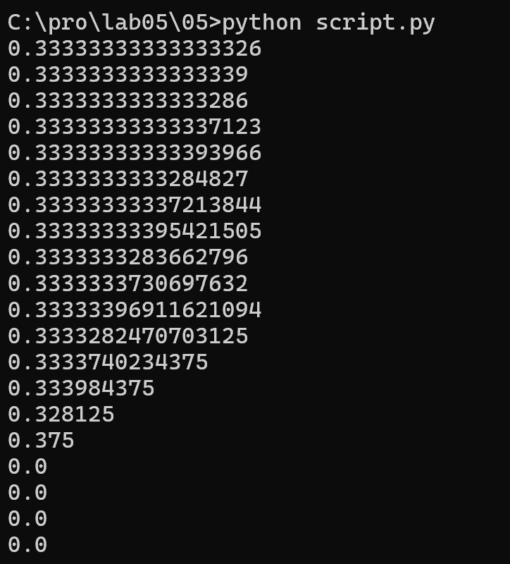
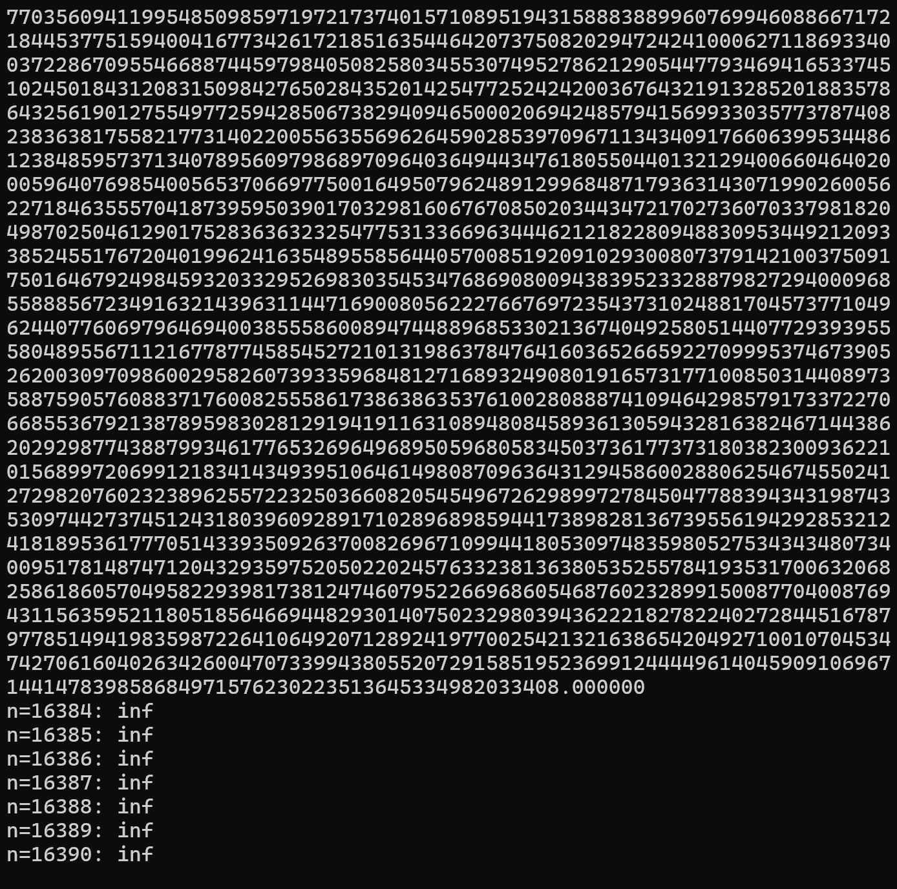
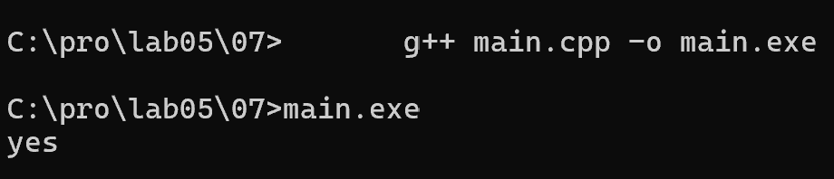

# Языки программирования
## Лабораторная работа 5

### Задание 1 **(2)**
*Переведите в двоичную запись два произвольных рациональных числа (числа вида* $\frac{p}{q}$).
*У одного из чисел знаменатель должен быть степенью двойки (32), а у другого --- некоторым числом
от 9 до 12.*

## Число со знаменателем 32: 13/32

* Целая часть: 13 < 32, значит целая часть равна 0.

Знаменатель 32 = 2^5, поэтому записываем числитель 13 в 5 битах после точки.

* 13 в двоичном виде: 01101

* Ответ: 13/32 = 0.01101 (2)

## Число со знаменателем 10: 7/10

* Целая часть: 7 < 10, значит целая часть равна 0.

* Переводим дробную часть 0.7 в двоичную умножением на 2:
```
0.7 * 2 = 1.4 -> 1, остаток 0.4
0.4 * 2 = 0.8 -> 0, остаток 0.8
0.8 * 2 = 1.6 -> 1, остаток 0.6
0.6 * 2 = 1.2 -> 1, остаток 0.2
0.2 * 2 = 0.4 -> 0, остаток 0.4  (вернулись к началу)
```

* С остатка 0.4 последовательность повторяется: `0 0 1 1`
* Цифры после точки: `1 0 1 1 0 0 1 1 0 0 ...`

* Период: `0011`

* Ответ: `7/10 = 0.1(0011) (2)`

*Запись второго числа будет содержать период. Его надо найти. При решении задачи нельзя 
использовать вычислительную технику. Процесс решения должен быть представлен в отчете.*


### Задание 2 **(3)**
*Переведите в двоичную запись и найдите машинное представление в типе* **double**
*для произвольного вещественного числа большего, чем 100 с одним знаком после точки, например
для* $113.7$. *Цифра после точки не должна быть нулем иля пятеркой.*

Целая часть: `113 = 1110001 (2)`
```
113 / 2 = 56, остаток 1
 56 / 2 = 28, остаток 0
 28 / 2 = 14, остаток 0
 14 / 2 =  7, остаток 0
  7 / 2 =  3, остаток 1
  3 / 2 =  1, остаток 1
  1 / 2 =  0, остаток 1
```

Дробная часть: `0.7 = 0.1(0011) (2)`
```
0.7 · 2 = 1.4  -> пишем 1, дальше работаем с 0.4
0.4 · 2 = 0.8  -> пишем 0, дальше работаем с 0.8
0.8 · 2 = 1.6  -> пишем 1, дальше работаем с 0.6
0.6 · 2 = 1.2  -> пишем 1, дальше работаем с 0.2
0.2 · 2 = 0.4  -> пишем 0, дальше работаем с 0.4
```

Итог: `113.7 = 1110001.1(0011) (2)`


*При решении задачи нельзя 
использовать вычислительную технику. Процесс решения должен быть представлен в отчете.*


### Задание 3 **(3)**
*Найдите сумму и произведение для записанных далее пар чисел. Числа заданы в двоичной записи 
в экспоненциальном виде. Ответ необходимо записать в нормализованннои экспоненциальном виде.*

* 1.0011e18 и $1.1001e21; 

Приводим к меньшей экспоненте (18):
1.1001e21 = 1100.1 * 2^18

```
  0001.0011
+ 1100.1000
-----------
  1101.1011
```

`1101.1011 * 2^18 = 1.1011011 * 2^21`
Сумма: 1.1011011e21

Умножение:
Мантиссы: 1.0011 * 1.1001 = 1.11011011
Экспоненты: 18 + 21 = 39

Произведение: 1.11011011e39


* 1.1011e-25 и 1.1101e-23

Приводим к меньшей экспоненте (-25):
1.1101e-23 = 111.01 * 2^(-25)

```
  001.1011
+ 111.0100
----------
 1000.1111
```

`1000.1111 * 2^(-25) = 1.0001111 * 2^(-22)`

Сумма: 1.0001111e-22

Умножение:
Мантиссы: 1.1011 * 1.1101 = 11.00001111 = 1.100001111 * 2^1
Экспоненты: -25 + (-23) + 1 = -47

Произведение: 1.100001111e-47

* 1.1011e-3 и 1.1011e1

Приводим к меньшей экспоненте (-3):
1.1011e1 = 11011 * 2^(-3)

```
  00001.1011
+ 11011.0000
------------
 11100.1011
```

`11100.1011 * 2^(-3) = 1.11001011 * 2^1`

Сумма: 1.11001011e1

Умножение:
Мантиссы: 1.1011 * 1.1011 = 10.11011001 = 1.011011001 * 2^1
Экспоненты: -3 + 1 + 1 = -1

Произведение: 1.011011001e-1

*При решении задачи нельзя 
использовать вычислительную технику. Процесс решения должен быть представлен в отчете.*


### Задание 4 **(2)**

*Рассмотрим следующий пример в IDLE Python*
 
```
>>> x = 99.99
>>> int(x/10+0.001)
9
```

Числа `99.99` и `0.001` не представимы точно в типе float (двоичная
дробь с конечным числом разрядов). Они хранятся с погрешностью.
`99.99` на самом деле хранится как `99.98999999999999488...`

Тогда:
```
99.98999999999999488 / 10 = 9.998999999999999488
9.998999999999999488 + 0.001 = 9.999999999999999488
int(9.999999999999999488) = 9
```

Потому что int() отбрасывает дробную часть, а число чуть
меньше 10.

## как исправить

* Использовать round:

`int(round(x / 10 + 0.001))`

Вывод: 10

`round` — это встроенная функция Python, которая округляет число до
ближайшего целого (или до указанного количества знаков после точки).

*Результат должен был быть равен 10, однако оказался другим. Почему так произошло?
Как исправить программу, чтобы она корректно переводила вещественные числа в целые?*

### Задание 5. **(2)**


*Рассмотрите следующую программу. Объясните результаты ее работы. В частности,
как величина* $y$ *повлияла на ответ?*
```
x = 1/3
y = 1
for i in range(20):
    print((x+y)-y)
    y*=10
```



Логически `(x + y) - y = x` всегда. Но из-за погрешности float
результат меняется.

Число 1/3 хранится с погрешностью. Мантисса float занимает
52 бита, что даёт примерно 15-16 десятичных знаков точности.

Когда `y` мало `(1, 10, 100, ...)`, сумма `x + y` хранится точно,
и вычитание возвращает x.

Когда `y` становится большим (10^15 и больше), сумма `x + y`
требует больше 15 знаков. Мантисса float не может хранить
одновременно всю целую часть `y` и дробную часть `x`.
Младшие биты `x` теряются.

В пределе `(x + y) - y = 0`

Чем больше `y`, тем сильнее теряется точность `x`.
Это свойство чисел с плавающей точкой.

*В отчете требуется привести вычисления для оценки погрешности.*


### Задание 6 **(2)**

*Для какого минимального значения* $n$ *программа на С++ выведет* **inf**? *Объясните
ответ.* *Что произойдет, если тип* **double** *заменить на* **long double**?
```
int n=...;
double s = pow(2, n);
std::cout << std::fixed << s << std::endl;
```

Для double: n = 1024
Для long double: n = 16384



double занимает 64 бита (11 бит экспонента). Максимальное
значение ~ 2^1024. Поэтому 2^1024 даёт inf.

long double (x86, 80 бит, 15 бит экспонента) даёт inf при n = 16384.


### Задание 7 **(2)**

*Допишите что-либо вместо многоточия программе на С++, чтобы программа при запуске выдавала ответ* **yes**.
```
double s = ...;
if (s != s)
  std::cout << "yes";
```
* код программы:

```
#include <iostream>

int main() {
    double s = 0.0 / 0.0;
    if (s != s)
        std::cout << "yes";
    return 0;
}
```


0.0 / 0.0 даёт NaN (Not a Number - "не число").
Особенность NaN: он не равен самому себе, поэтому s != s истинно.
Для всех обычных чисел s == s, и условие было бы ложным.


### Задание 8 **(2)**

*Какое минимальное натуральное число при преобразовании в тип* **double** *записывается с погрешностью? Объясните
ответ. Почему следующее за ним число уже выводится без погрешности?*

Минимальное число: 2^53 + 1 = 9007199254740993

double имеет 52 бита мантиссы плюс 1 неявный ведущий бит = 53 бита точности.

Это значит, что double точно хранит все целые числа до 2^53 включительно.

2^53 = 9007199254740992 - точно представимо.

2^53 + 1 = 9007199254740993 - НЕ представимо.
Для его хранения нужен 53-й бит после ведущей единицы, которого нет.
Поэтому число округляется до 2^53.

* Почему следующее число без погрешности

2^53 + 2 = 9007199254740994 - представимо точно.
Его последняя значащая единица стоит на 1-м бите, а не на 0-м.
Мантиссы хватает.

Нечётные числа после 2^53 теряются, а чётные представляются точно.

```
#include <iostream>
#include <iomanip>

int main() {
    long long a = 9007199254740993LL;
    double d = a;
    std::cout << std::fixed << std::setprecision(0) << d << std::endl;
    return 0;
}
```

Минимальное число, теряющее точность в double: 2^53 + 1.
Все целые числа до 2^53 хранятся точно.


###  Задание 9 **(2)**
*Напишите программу для решения следующей задачи.*

*Даны четыре рациональных числа. (Рациональное число - это число вида*
$\frac{p}{q}$, *где* $p$ *и* $q$ - *целые числа.) Напишите программу, которая сравнит сумму
двух первых чисел с суммой двух последних чисел. Программа должна выводить* $1$, $0$ *или* $-1$
*в зависимости от результатов сравнения. Решение можно проверить в проверяющей системе*
[http://olymp3.isu.ru/cgi-bin/new-client?contest_id=102](http://olymp3.isu.ru/cgi-bin/new-client?contest_id=102), *задача 03*.

```
#include <iostream>

int main() {
    long long a, b, c, d, e, f, g, h;
    std::cin >> a >> b >> c >> d >> e >> f >> g >> h;

    long long left = (a * d + c * b) * (f * h);
    long long right = (e * h + g * f) * (b * d);

    if (left > right)
        std::cout << 1 << std::endl;
    else if (left < right)
        std::cout << -1 << std::endl;
    else
        std::cout << 0 << std::endl;

    return 0;
}
```

Чтобы сравнивать дроби без погрешностей, приводим их к общему
знаменателю и перемножаем крест-накрест.

`(a/b + c/d) = (a*d + c*b) / (b*d)`
`(e/f + g/h) = (e*h + g*f) / (f*h)`

Сравниваем:
`(a*d + c*b) * (f*h)   и   (e*h + g*f) * (b*d)`

Обе части - целые числа. Сравнение точное, без погрешностей.

Тип long long используется, чтобы избежать переполнения.

Программа выводит:
`1`, если `a/b + c/d > e/f + g/h`
`-1`, если `a/b + c/d < e/f + g/h`
`0`, если суммы равны


## Дополнительные задания

### Задание 1 **(3)**

*Чем отличаются машинные представления чисел* $1$, $4096$, $0.0625$, *в типе* **double**? *Почему?*

### Задание 2 **(4)**
*Напишите программу для решения следующей задачи.*

*Даны четыре вещественных числа
a,b,c,d, не превосходящие 100 по модулю, записанные не более чем с 10 знаками после точки.
Требуется сравнить суммы a+b и c+d и определить, какая из них больше. Возможен случай,
что суммы будут равны.* 

*От вас требуется обосновать выбор значения* **eps** *при сравнении.*

### Задание 3 **(5)**
*Задано вещественное число в десятичной записи. Напишите программу для нахождения первых 1000 разрядов
этого числа в двоичной записи.*


### Задание 4 **(3)**
*Изучая чужой код, программист обнаружил такую функцию.*
```
long double acos_e(long double x, long double ep){
  if (x > 1+ep || x < -1-ep)
    return 0.0 / 0.0;
  else if (x>1)
    x=1;
  else if (x<-1)
    x=-1;
  return acos(x);
}
```
*Чем отличается эта функция от обычной функции арккосинуса? В чем смысл дополнительных проверок?*
### Задание 5 **(5)**
*Заданы координаты точек* $A$, $B$, $C$ *на плоскости. Координаты являются вещественными числами в диапазоне* $[0;10)$
*и содержат не более 6 знаков после точки. Используя формулу векторного произведения, напишите программу
для определения расположения* $C$ *относительно вектора* $AB$ *(слева, справа, на прямой).*

*От вас требуется обосновать выбор значения* **eps** при сравнении.*