# Языки программирования
## Лабораторная работа 6

### Задание 1 **(3)**
*Рассмотрим следующую программу на С++.*
```
#include <iostream>
#include <cmath>
int main() {
   double x = 0;
   const auto Pi = std::acos(0) * 2;
   std::cout << Pi << std::endl;
   return 0;
}
```
*Проверьте четыре способа объявления* **Pi**.

* вариант1: ```const auto Pi = acos(0) * 2;```

```
#include <iostream>
#include <cmath>

int main() {
    double x = 0;
    const auto Pi = std::acos(0) * 2;
    std::cout << Pi << std::endl;
    return 0;
}
```

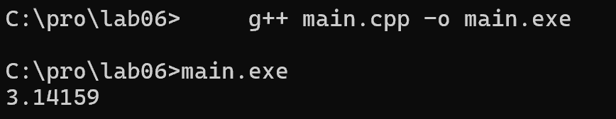

Результат: работает, выводит 3.14159.

Пояснение: const auto - константа времени выполнения,
потому что std::acos(0) вычисляется во время работы.
НЕ константа этапа трансляции.

* вариант2: ```constexpr auto Pi = std::acos(0) * 2;```

```
#include <iostream>
#include <cmath>

int main() {
    double x = 0;
    constexpr auto Pi = std::acos(0) * 2;
    std::cout << Pi << std::endl;
    return 0;
}
```
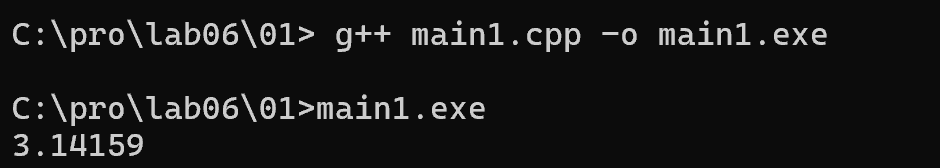

Результат: работает, выводит 3.14159.

Пояснение: это происходит потому, что `g++` считает математические функции 
встроенными (builtin) и умеет вычислять их на этапе компиляции. 
По стандарту C++17/C++20 функция `std::acos` не является `constexpr`, 
поэтому другие компиляторы (например, `clang++` или MSVC) выдают ошибку.

`constexpr variable 'Pi' must be initialized by a constant expression`
 
* вариант3: ```const auto Pi = acos(x) * 2;```

```
#include <iostream>
#include <cmath>

int main() {
    double x = 0;
    const auto Pi = std::acos(x) * 2;
    std::cout << Pi << std::endl;
    return 0;
}
```
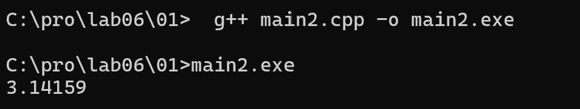

Результат: работает, выводит 3.14159.

Пояснение: const auto, значение зависит от x (переменной),
поэтому это константа времени выполнения.

* вариан3: ```constexpr auto Pi = std::acos(x) * 2;```

```
#include <iostream>
#include <cmath>

int main() {
    double x = 0;
    constexpr auto Pi = std::acos(x) * 2;
    std::cout << Pi << std::endl;
    return 0;
}
```
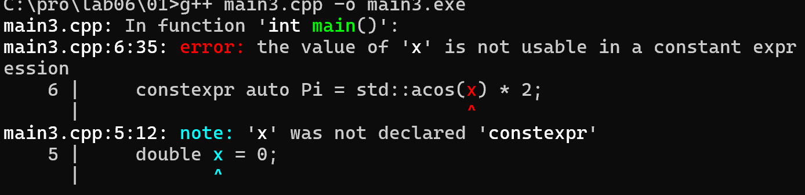

Результат: ошибка компиляции.

Пояснение: constexpr требует, чтобы значение было известно
на этапе компиляции, но x - переменная.

## вывод:

Константа этапа трансляции должна объявляться через constexpr
и использовать только значения, известные на этапе компиляции.

Вариант 2 - константа этапа трансляции (на C++20).
Варианты 1 и 3 - константы времени выполнения.
Вариант 4 - ошибка компиляции, потому что x не известен
на этапе компиляции.

*Что можно сказать об этих вариантах? Проверьте, в каких вариантах объявляется константа этапа трасляции.*

*Тексты программ разместите в папке с номером задания*


### Задание 2 **(2)**
*Проверьте работу следующей программы на С++*
```
#include <iostream>
int main() {
   {
      int x, y;
      std::cin >> x >> y;
      std::cout << x+y << std::endl;
   }
   {
      double x, y;
      std::cin >> x >> y;
      std::cout << x+y << std::endl;
   }
   return 0;
}
```

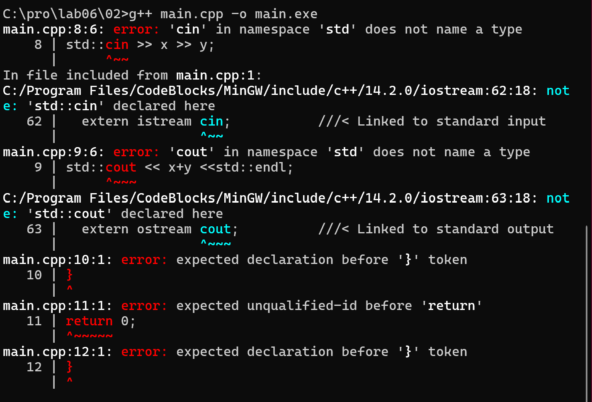

* правильный код:

```
#include <iostream>

int main() {
    int x, y;
    std::cin >> x >> y;
    std::cout << x + y << std::endl;

    {
        double x, y;
        std::cin >> x >> y;
        std::cout << x + y << std::endl;
    }

    return 0;
}
```
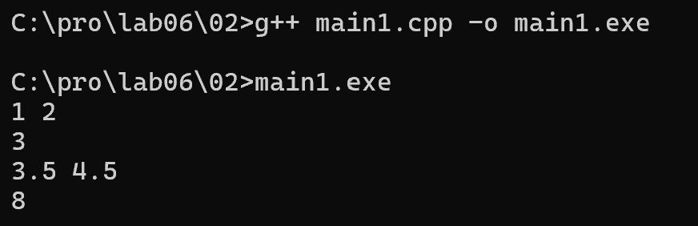

## Пояснение

В C++ в одном блоке нельзя повторно объявлять переменную
с тем же именем.

Внешние x, y имеют тип int.
Внутренние x, y - тип double, это другие переменные.

Вложенные фигурные скобки { } создают новый блок
(новую область видимости). Внутри него можно объявить
переменные с теми же именами, что и снаружи.
Они "перекрывают" внешние, пока выполняется блок.

При выходе из внутреннего блока внутренние переменные
удаляются, и снова доступны внешние.

## Вывод

Вложенные скобки НУЖНЫ. Без них компилятор выдаёт
ошибку повторного объявления.

*Нужны ли в этой программе вложенные фигурные скобки? Дайте подробный ответ с объяснением причин.*


### Задание 3 **(2)**
*Проверьте работу следующего фрагмента программы на С++.*
```
int s = 0;
for (int i = 0; i < 4; i++) {
   for (int i = 0; i < 3; i++) {
      s += i;
   } 
   s += i; 
}
std::cout << s;
```
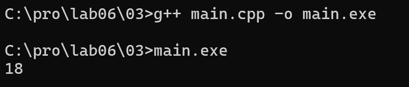

## Разбор вычислений

Переменная s = 0.

Внешний цикл по i = 0, 1, 2, 3.

Для каждого i внутренний цикл добавляет 0+1+2 = 3 к s.
Внутренний цикл выполняется 4 раза (по 3 итерации),
итого: 4 * 3 = 12.

Внешний s += i добавляет 0+1+2+3 = 6.

Всего: 12 + 6 = 18.

## Почему так работает

В C++ вложенный цикл создаёт новую область видимости.
Внутренняя переменная i перекрывает внешнюю, пока
выполняется внутренний цикл.

Когда внутренний цикл завершается, снова доступна
внешняя i, значение которой не изменилось.

Поэтому после внутреннего цикла s += i добавляет
внешнюю i, а не внутреннюю.

## Вывод

Программа выводит 18.
Вложенные переменные i - это разные переменные,
они не конфликтуют.

*В результате каких вычислений был получен ответ? Дайте подробный ответ.*


### Задание 4 **(2)**

*Проверьте работу следующего фрагмента программы на* **Python**.
```
s = 0
for i in range(4):
   for i in range(3):
      s += i
   s += i
print(s)
```
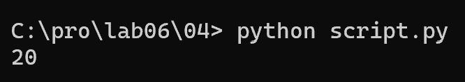

## Разбор вычислений

s = 0.

Внешний цикл (i = 0, 1, 2, 3):

Итерация 1: внешняя i = 0.
  Внутренний цикл: i = 0, 1, 2 -> s += 0+1+2 -> s = 3.
  После внутреннего цикла i = 2.
  s += i -> s = 3 + 2 = 5.

Итерация 2: внешняя i = 1 (но её сразу перезапишет
внутренний цикл).
  Внутренний цикл: i = 0, 1, 2 -> s += 0+1+2 -> s = 8.
  i = 2.
  s += i -> s = 8 + 2 = 10.

Итерация 3:
  Внутренний цикл -> s += 3 -> s = 13.
  s += 2 -> s = 15.

Итерация 4:
  Внутренний цикл -> s += 3 -> s = 18.
  s += 2 -> s = 20.

Итог: s = 20.

## Разница между C++ и Python

В C++ вложенный цикл создаёт новую область видимости.
Внутренняя переменная i - отдельная, не связана с внешней.
После внутреннего цикла внешняя i остаётся 0, 1, 2, 3.
Поэтому s += i добавляет 0+1+2+3 = 6.
Итог C++: 12 + 6 = 18.

В Python переменная i одна (нет блочной области видимости
для циклов). Внутренний цикл перезаписывает i на 0, 1, 2.
После внутреннего цикла i всегда = 2.
Поэтому s += i добавляет 2+2+2+2 = 8.
Итог Python: 12 + 8 = 20.

## Вывод

В C++ - 18, в Python - 20.
Причина различия: в C++ переменные имеют блочную
область видимости, а в Python - функцияльную.

*В результате каких вычислений был получен ответ? Дайте подробный ответ.*

*На основе этих примеров поясните различия между* **С++** и **Python** *при работе с переменными*.


### Задание 5 **(2)**


*Напишите свой пример программы на* **С++**, *создающий и использующий пространства имен. Программа
должна содержать не менее двух пространств имен.*

```
#include <iostream>

namespace first {
    int x = 1;
    void hello() {
        std::cout << "Privet iz first" << std::endl;
    }
}

namespace second {
    int x = 2;
    void hello() {
        std::cout << "Privet iz second" << std::endl;
    }
}

int main() {
    std::cout << first::x << std::endl;
    std::cout << second::x << std::endl;

    first::hello();
    second::hello();

    using namespace second;
    std::cout << x << std::endl;
    hello();

    return 0;
}
```
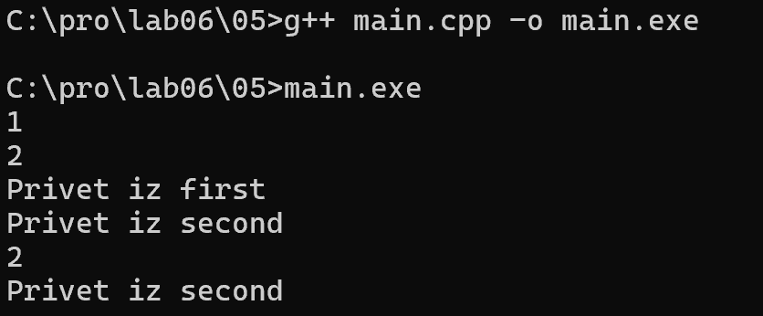

## Пояснение

first::x - x из first (1).
second::x - x из second (2).

first::hello() вызывает hello из first.
second::hello() вызывает hello из second.

using namespace second; - раскрываем все имена
из пространства second. Теперь x без префикса
= second::x = 2, hello() = second::hello().

## Вывод

Пространства имен позволяют использовать одинаковые
имена переменных и функций в разных частях программы
без конфликтов.


### Задание 6 **(2)**

*Рассмотрим следующий фрагмент программы. Эта программа 1000000 раз обменивает значения двух длинных 
строк с использованием третьей строки. Проверьте, насколько быстро она работает.*

```
std::string a(100000, 'a');
std::string b(100000, 'b');
for (int i=0;i<1000000;i++) {
   std::string c(a);
   a = b;
   b = c;
}
std::cout << a[0] << b[0];
```
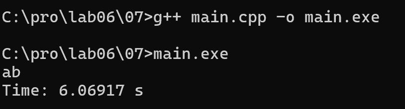

Результат: работает около 6 секунд (6.06917 s).

Ошибка: на каждой итерации выполняется три полных копирования
строки по 100000 символов. Всего 1000000 * 3 * 100000 = 300 ГБ данных.

## код с использованием swap

```
#include <iostream>
#include <string>
#include <chrono>

int main() {
    auto start = std::chrono::steady_clock::now();
    std::string a(100000, 'a');
    std::string b(100000, 'b');
    for (int i=0; i<1000000; i++) {
        std::swap(a, b);
    }
    std::cout << a[0] << b[0] << std::endl;
    auto end = std::chrono::steady_clock::now();
    std::cout << "Time: " << std::chrono::duration<double>(end - start).count() << " s" << std::endl;
    return 0;
}
```
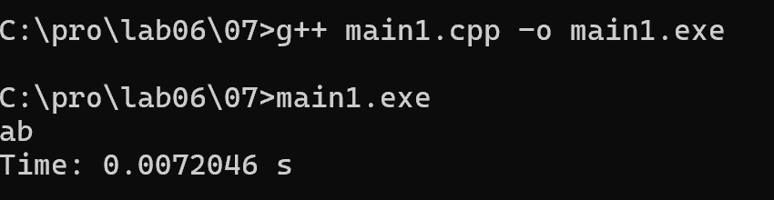 

Результат: работает около 0.007 секунды (0.0072046 s).
Время уменьшилось примерно в 800 раз.

Пояснение: swap не копирует символы строк, а только обменивает
внутренние указатели на данные, длину и ёмкость.

## исправленная исходная программа 

```
#include <iostream>
#include <string>
#include <chrono>
#include <utility>

int main() {
    auto start = std::chrono::steady_clock::now();
    std::string a(100000, 'a');
    std::string b(100000, 'b');
    for (int i=0; i<1000000; i++) {
        std::string c(std::move(a));
        a = std::move(b);
        b = std::move(c);
    }
    std::cout << a[0] << b[0] << std::endl;
    auto end = std::chrono::steady_clock::now();
    std::cout << "Time: " << std::chrono::duration<double>(end - start).count() << " s" << std::endl;
    return 0;
}
```


Результат: работает около 0.015 секунды (0.0151377 s).
Время уменьшилось примерно в 400 раз, стало сравнимо с swap.

Пояснение: std::move позволяет вместо копирования использовать
перемещение. Строка забирает указатель на данные у исходной строки.
Общий вид программы сохранился (временная переменная и три присваивания).

## Вывод

Исходная программа медленная из-за копирования строк.
swap решает проблему, но меняет вид программы.
std::move сохраняет вид и ускоряет программу в сотни раз.

*Попробуйте использовать для обмена значений строк функцию* **swap**. 
*Проверьте, изменилось ли время работы. В чем ошибка исходной программы?
Исправьте исходную программу, чтобы ускорить ее работу. Изменения не должны 
затрагивать общий вид программы (присваивания, использование временной переменной).*


### Задание 7 **(2)**

*Рассмотрим программу на языке* **Python**.
```
a = 'Hello world'
print(a, id(a))
b = a
print(b, id(b))
a += ' and goodbye'
print(a, id(a))
print(b, id(b))
```
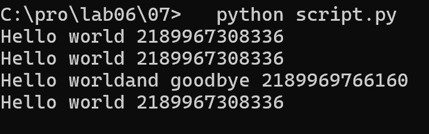

## Пояснение

В Python строки неизменяемые. id() возвращает адрес
объекта в памяти. Если id одинаковые, значит переменные
ссылаются на один и тот же объект.

a = 'Hello world' -> создается строка 1.
  a ссылается на строку 1.

b = a -> b получает ту же ссылку.
  id(a) == id(b). Новая строка НЕ создается.

a += 'and goodbye' -> это a = a + '...'.
  Строки нельзя менять, поэтому создается строка 2
  ('Hello worldand goodbye'). a теперь ссылается на строку 2.
  id(a) изменился.

b по-прежнему ссылается на строку 1.
  id(b) не изменился.

## Когда создавались строки

Строка 1 ('Hello world') - при первом присваивании a.
Строка 2 ('Hello worldand goodbye') - при выполнении a +=.

## Вывод

a и b сначала ссылались на одну строку. После a += создалась
новая строка, и a стала ссылаться на нее. b осталась на старой.

*Объясните ее работу. В какой момент создавались строки? 
Что означает значение, возвращенное функцией* **id**?

### Задание 8 **(2)**

*Пусть* **a** - *строковая переменная в программе на* **Python**.
*Есть ли разница между работой присваивания*
```b = a```
и
```b = a[:]```
*Напишите программу для демонстрации различий.*

```
a = 'Hello world'

b = a
c = a[:]

print(a, id(a))
print(b, id(b))
print(c, id(c))

print("b = a:", id(a) == id(b))
print("c = a[:]:", id(a) == id(c))
```

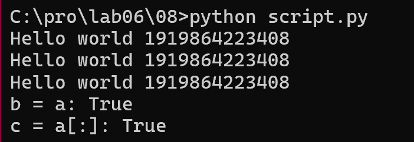

## Пояснение

b = a - b получает ту же ссылку, что и a. b is a -> True.

c = a[:] - обычно срез создает новую строку (копию).
Но в моей версии Python интерпретатор оптимизирует
создание строк: короткие строки кешируются, и даже
срез a[:] возвращает ссылку на тот же объект.
Поэтому c is a -> True.

Это особенность конкретного интерпретатора Python,
а не ошибка в коде.

## Практическая разница

Для строк разница не важна, потому что строки неизменяемые.
Изменить строку через b или c нельзя - можно только создать новую.


###  Задание 9 **(3)**
*Напишите программу на языке* **Python**, *которая создаст 2600 переменных с именами
от* **a0** *до* **a99**, *от* **b0** *до* **b99** *и так далее, от* **z0** *до* **z99**. 
*Присвойте всем переменным различные значения от 1 до 2600.*

```
count = 1

for letter in "abcdefghijklmnopqrstuvwxyz":
    for i in range(100):
        name = letter + str(i)
        globals()[name] = count
        count = count + 1

print("Vsego peremennyh:", count - 1)
print("a0 =", a0)
print("a99 =", a99)
print("z99 =", z99)
```
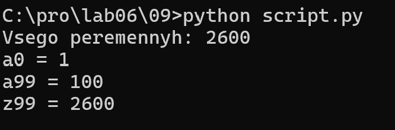

## Пояснение

globals() - словарь глобальных переменных.
Ключ - имя переменной, значение - ее значение.
Запись globals()['a0'] = 1 создает переменную a0 = 1.

Внешний цикл перебирает 26 букв (a-z).
Внутренний цикл - 100 чисел (0-99).
Всего 26 * 100 = 2600 переменных.

name = letter + str(i) - собираем имя: 'a' + '0' = 'a0'.
count - значение от 1 до 2600.

## Вывод

Программа создает 2600 переменных через словарь globals()
и присваивает им значения от 1 до 2600.
## Дополнительные задания

### Задание 1 **(3)**

*Пусть* **a**, **b**  *два списка в* **Python**. *Мы хотим обменять значения переменных следующим
образом.*
```
a, b = b, a
```
*Будет ли это работать? В какой последовательности будут происходить присваивания?
Будет ли зависеть время работы от размера списков? Обоснуйте ответ.*

### Задание 2 **(3)**
*Проверьте результаты сравнения в* **Python**.
```
id(100)==id(100)
```
и
```
id(1000)==id(1000)
```
*Как можно объяснить полученные результаты?*

### Задание 3 **(4)**
*Напишите функцию* **sumint** на **Python**, *которая найдет сумму всех целочисленных переменных, определенных
в среде* **Idle**. *Например*
```
>>> a = 10
>>> b = 1.5
>>> c = 15
>>> d = 'hello'
>>> sumint()
25
```

### Задание 4 **(10)**

*В языке* **С++** *для получения информации о расположении переменной в памяти 
можно использовать оператор взятия адреса* **&**. *Адрес можно интерпретировать, как 
беззнаковое длинное число с использованием* **reinterpret_cast**.

```
reiterpret_cast<unsigned long long>(&t);
```
*Здесь* **t** *имя некоторой переменной. Напишите несколько примеров, чтобы проверить, 
как размещаются переменные в памяти. В частности, можно рассмотреть следующие вопросы.*
* *Если объявить несколько переменных различных типов в одном блоке, то на какую величину 
отличаются их адреса? Соотносится ли эта величина с размером переменной в байтах.
Проверьте, имеются ли различия на разных уровнях оптимизации.*
* *Если имеется несколько блоков, расположенных последовательно, то могут ли переменные
в разных блоках иметь одинаковые адреса? Проверьте разные уровни оптимизации.*
* *Объявите несколько переменных типа* **std::string** *и попробуйте заносить
в них строки различной длины. Изменяется ли размер переменной, вычисленный с использованием*
**sizeof**? *Изменяется ли расположение переменной? Попробуйте объяснить полученные результаты.*

