# Языки программирования
## Лабораторная работа 7

### Задание 1 **(2)**
*Оцените работу следующих фрагментов программ. Какие из них обладают неоднозначным поведением? Почему?*
```
int x=10, y=3;
std::cout << std::min(x=15, x+y);
```
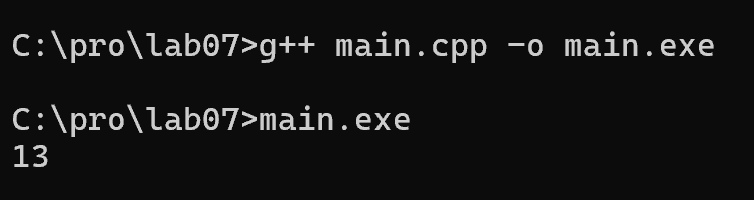
Поведение: неоднозначное.

Пояснение: порядок вычисления аргументов функции не определен. 
Если сначала вычислят x=15, то x+y = 18.
Если сначала x+y, то x+y = 13. Результат зависит от компилятора.


```
int x=10, y=3;
x=15, y+=x, x+=y;
```
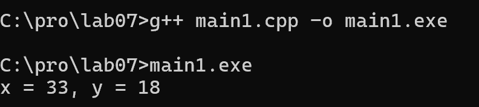
Поведение: однозначное.
Результат: x = 33, y = 18.

Пояснение: оператор "запятая" вычисляется строго слева направо. 
Сначала x=15, потом y=3+15=18, потом x=15+18=33.


```
int x=10, y=9;
if (x>y++ && y++>9)
  cout << "yes" << endl;
cout << y;
```
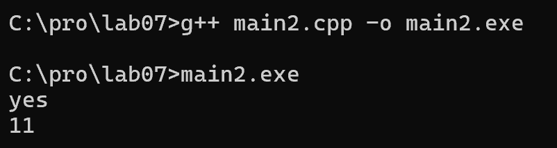
Поведение: однозначное.
Результат: yes, 11.

Пояснение: оператор && вычисляется слева направо с сокращением. 
10>9 (true, y=10), затем 10>9 (true, y=11).

## Вывод

Неоднозначным является только фрагмент 1 (min).
Фрагменты 2 и 3 однозначны, так как операторы , и && гарантируют
порядок вычисления.

*Тексты программ разместите в папке с номером задания*


### Задание 2 **(2)**
*Как записать следующие строки программы на С++ в виде одного
выражения? Приведите несколько способов, в том числе с использованием операторов инкремента.*
*Проверьте работу написанных программ*
```
x=x+1;
z=z+2*x+3*y;
y=y+1;
```

* 1 способ
```
#include <iostream>
using namespace std;

int main() {
    int x = 1, y = 2, z = 3;
    
    x++, z = z + 2*x + 3*y, y++;
    
    cout << "x = " << x << ", y = " << y << ", z = " << z << endl;
    return 0;
}
```
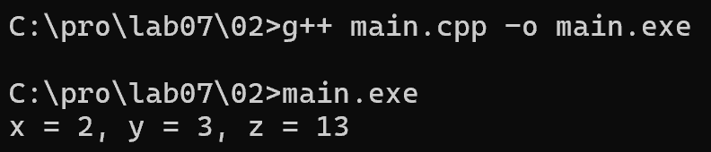


* 3 способ
```
#include <iostream>
using namespace std;

int main() {
    int x = 1, y = 2, z = 3;
    
    ++x, z = z + 2*x + 3*y, ++y;
    
    cout << "x = " << x << ", y = " << y << ", z = " << z << endl;
    return 0;
}
```
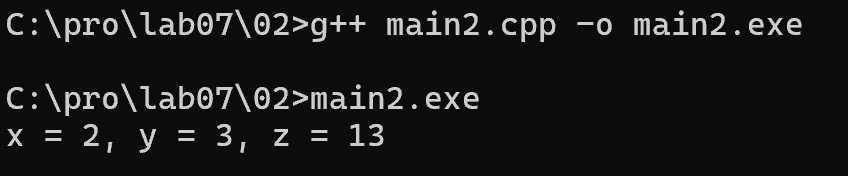


* 3 способ
```
#include <iostream>
using namespace std;

int main() {
    int x = 1, y = 2, z = 3;
    
    x++, z += 2*x + 3*y, y++;
    
    cout << "x = " << x << ", y = " << y << ", z = " << z << endl;
    return 0;
}
```
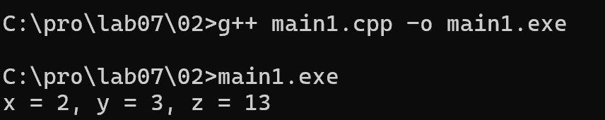

## Пояснение

Оператор "запятая" позволяет объединить несколько выражений
в одно. Вычисления идут строго слева направо.

`x++` - увеличивает x на 1 (постфиксный).
`++x` - тоже увеличивает x на 1 (префиксный).
Оба варианта подходят, так как используются как отдельные
выражения перед основной формулой.

`z = z + 2*x + 3*y` - использует уже новое значение x
и старое значение y.

`y++` - увеличивает y на 1.

## Вывод

Все три способа дают одинаковый результат:
x = 2, y = 3, z = 13.

*Тексты программ разместите в папке с номером задания*

### Задание 3 **(2)**
*Рассмотрите следующий фрагмент программы. Он заполняет вектор из 10 элементов единицами.*
```
std::vector<int> x(10);
for (int i = 0; i < 10;)
   x[i++] = 1;
```

*Перепишите ее так, чтобы в третьей строке использовался префиксный инкремент, но результат ее работы не изменился.*
```
std::vector<int> x(10);
for (...)
   x[++i]=1;
```


* код:
```
#include <iostream>
#include <vector>
using namespace std;

int main() {
    vector<int> x(10);
    
    for (int i = -1; i < 9;) {
        x[++i] = 1;
        cout << x[i] << " ";
    }
    cout << endl;
    return 0;
}
```
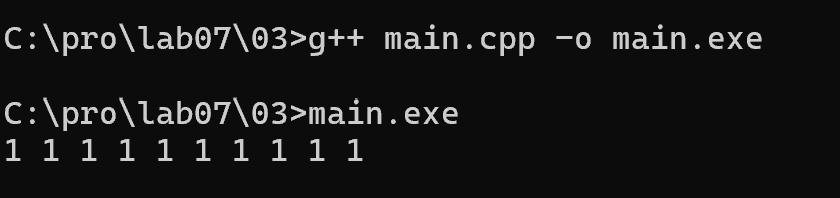

## Пояснение

Исходный цикл с i++:
```
i = 0: x[0] = 1, i = 1
...
i = 9: x[9] = 1, i = 10
```

Если просто заменить на ++i, то:
`i = 0: ++i (i=1), x[1] = 1` - элемент x[0] пропущен!
`i = 9: ++i (i=10), x[10] = 1` - выход за границы!

Чтобы сохранить результат, начинаем i с -1:
`i = -1: ++i (i=0), x[0] = 1`
`i = 0: ++i (i=1), x[1] = 1`
...
`i = 8: ++i (i=9), x[9] = 1`
`i = 9:` условие i < 9 ложно, конец.

Индексы 0-9 заполнены. Результат совпадает с исходным.


### Задание 4 **(2)**

*Почему присваивание* ```(++x)=y``` *является синтаксически правильным, а*
```(x++)=y``` - *нет? Запишите текст сообщения об ошибке, переведите и объясните его.*

* `(++x) = y`:

```
#include <iostream>
using namespace std;

int main() {
    int x = 5, y = 10;
    
    (++x) = y;
    cout << "x = " << x << endl;
    
    return 0;
}
```
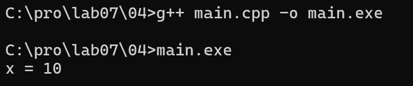

* `(x++) = y`:

```
#include <iostream>
using namespace std;

int main() {
    int x = 5, y = 10;
    (x++) = y; 
    
    cout << "x = " << x << endl;
    return 0;
}
```
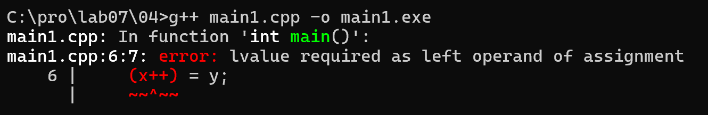

## Текст ошибки и перевод

error: lvalue required as left operand of assignment
Перевод: "требуется lvalue в качестве левого операнда присваивания".

## Пояснение

В C++ слева от знака = должно стоять lvalue - объект,
у которого есть адрес в памяти.

Префиксный ++x:
Результатом является сама переменная x. Это lvalue.
Поэтому (++x) = y работает: x увеличивается на 1,
потом в нее записывается y.

Постфиксный x++:
Результатом является временная копия старого значения x.
Это rvalue - у нее нет адреса в памяти.
Поэтому (x++) = y не работает: нельзя присвоить значение
временной копии, компилятор выдает ошибку.


### Задание 5 **(2)**

*Программисты на Python для обмена значений двух переменных часто пишут строку*
```
a,b = b,a
```

* через запятую:

```
#include <iostream>
using namespace std;

int main() {
    int a = 1, b = 2;
    
    cout << "До: a = " << a << ", b = " << b << endl;
    
    a, b = b, a;
    
    cout << "После: a = " << a << ", b = " << b << endl;
    
    return 0;
}
```
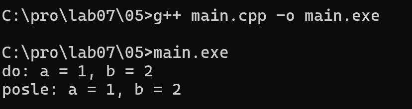

* через swap:

``` 
#include <iostream>
#include <utility>
using namespace std;

int main() {
    int a = 1, b = 2;
    
    cout << "До: a = " << a << ", b = " << b << endl;
    
    swap(a, b);
    
    cout << "После swap: a = " << a << ", b = " << b << endl;
    
    return 0;
}
```
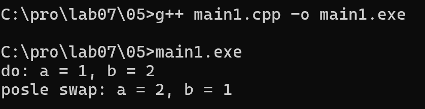

## Пояснение

В C++ запятая (,) — это оператор. Он вычисляет a, потом b=b, потом a.
Результат — a. Обмена нет.

В Python a, b = b, a — это кортежное присваивание, оно работает.
В C++ для обмена можно через swap.

*Проверьте, будет ли аналогичная строка на С++ (с точкой с запятой в конце) являться синтаксически
правильной? Будет ли она обменивать значения переменных? Как в языке С++ вычисляется это выражение?*


### Задание 6 **(2)**

*Проверьте работу следующего фрагмента программы*
```
  std::string s;
  for (int i=0; i<1000000; i++)
     s += 'a';
  std::cout << s.size();
```
*Измените третью строку на*
```
s=s+'a';
```
*Изменится ли что-нибудь в ее работе? Объясните результат.*

* +=:

```
#include <iostream>
#include <string>
using namespace std;

int main() {
    string s;
    for (int i = 0; i < 1000000; i++) s += 'a';
    cout << s.size() << endl;
    return 0;
}
```
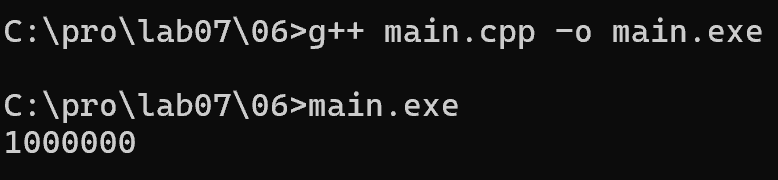

* `s = s + 'a'`:

```
#include <iostream>
#include <string>
using namespace std;

int main() {
    string s;
    for (int i = 0; i < 1000000; i++) s = s + 'a';
    cout << s.size() << endl;
    return 0;
}
```
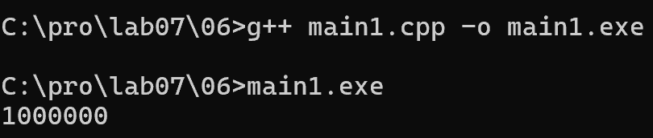

## Пояснение

Оба варианта выводят одинаковый размер строки (1000000).
Но работают они по-разному:

s += 'a' - это оператор добавления в конец. Строка расширяется
на месте, копирования всей строки не происходит.

s = s + 'a' - сначала создается временная строка (s + 'a'),
потом она присваивается s. Каждый раз копируется вся строка
целиком. Это медленнее, особенно при больших размерах.

На маленьких размерах разница незаметна. На 1000000 символов
второй вариант работает заметно дольше.

## Вывод

Результат (размер) одинаковый.
Разница - во времени работы: += быстрее, чем = с +,
потому что не создает временную копию всей строки.


### Задание 7 **(2)**

*Как работает следующая программа? Как зависит результат от исходного значения?*
```
int x;
std::cin >> x;
x-->0 && x-->0 && x-->0 && x-->0 && x-->0;
std::cout << x;
```

```
#include <iostream>
using namespace std;

int main() {
    int x;
    cin >> x;
    
    x-- > 0 && x-- > 0 && x-- > 0 && x-- > 0 && x-- > 0;
    
    cout << x << endl;
    return 0;
}
```
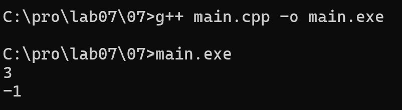

## пояснение

x-->0 - это не один оператор, а два: (x--) > 0.
Постфиксный декремент возвращает
старое значение x, а потом уменьшает x на 1.
Оператор && вычисляется слева направо с сокращением:
если левая часть false, правая не вычисляется.


###
 Задание 8 **(3)**

*Какое число выводит следующий фрагмент программы? Посчитайте результат без использования
вычислительной техники. Отчет должен содержать процесс вычислений.*
```
int s = 0;
for (int i = 0, j = 5;i+j <= 16;(i<j ? i : j)++)
   (s += i) += j;
std::cout << s;
```

###  Задание 9 **(3)**
*Рассмотрите следующую программу. Предполагается, что на вход подается некоторый
индекс в массиве - число от нуля до девяти и значение, которое надо записать по этому индексу.*
```
int i = 0;
std::vector<int> x(10);
std::cin >> i >> x[i];
std::cout << x[i];
```
*Проверьте работу этой программы на различных компиляторах. Найдите два компилятора (можно 
проверить онлайн компиляторы), на которых эта программа будет давать различные ответы при одинаковом
вводе. Как это объяснить?*

## Дополнительные задания

### Задание 1 **(2)**

*Найдите и объясните примеры "коварных" ошибок программистов на С++, связанных с вычислением выражений. 
Каждый пример оценивается в два балла. Примеры из лекции или из заданий не засчитываются.*

### Задание 2 **(10)**
*Язык С++ позволяет записывать достаточно странные конструкции.
Следующая программа обладает неопределенным поведением. После компиляции с использованием 
Gnu C++ (g++) эта программа выводит числа 4 и 11. Рассмотрите ассемблерный код и объясните,
каким образом был получен ответ 11.*
```
int x, y;
y = (x=1) + (x=2) + (x=3) + (x=4);
std::cout << x << " " << y;
```

### Задание 3 **(10)**
*Прочитайте в стандарте языка С++ правила вычисления результата для тернарного оператора* **?:**. *Напишите примеры для каждого пункта правил.*
