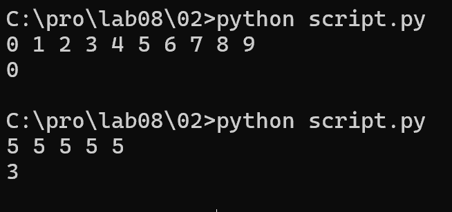
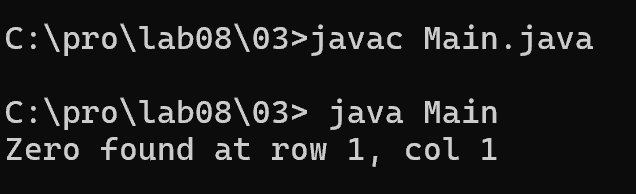
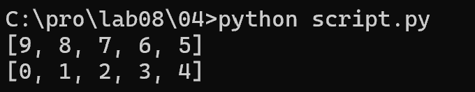
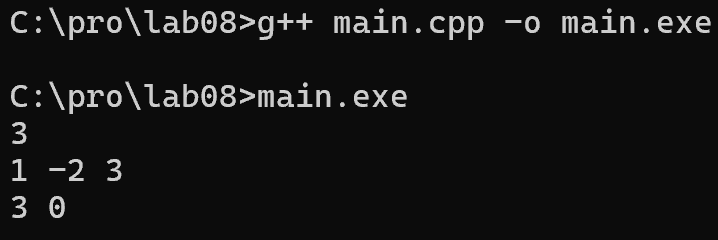
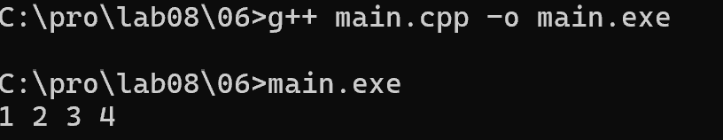
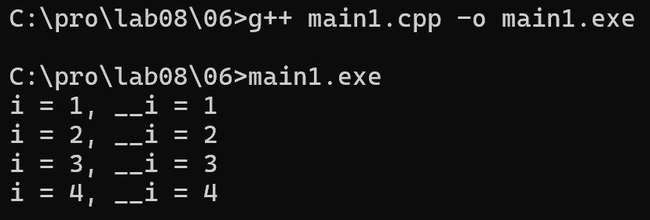
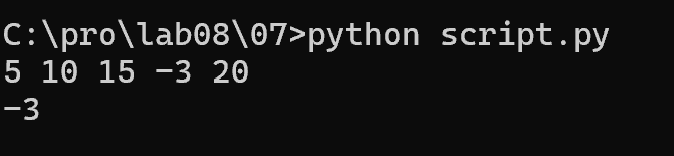
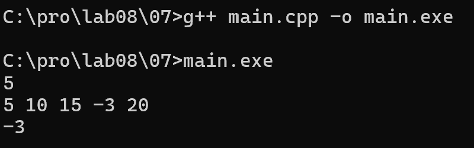
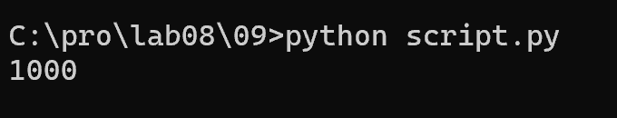

# Языки программирования
## Лабораторная работа 8

### Задание 1 **(2)**
*Рассмотрим программу на языке* **Python**.
```
x = [int(t) for t in input().split()]
for i in range(len(x)):
   if x[i] < i or x[i] > 2*i:
      break
print(i)
```
*Перепишите эту программу так, чтобы в ней использовался цикл* **while**, *в ней не использовалась
инструкция* **break**, *а используемый алгоритм не изменился. Полученная программа должна иметь следующий 
вид.*
```
x = [int(t) for t in input().split()]
i = 0
while ...:
   i += 1
print(i)
```
*Допишите правильное логическое выражение вместо многоточия. Выражение не должно содержать оператор* **not**.

## Код

```
x = [int(t) for t in input().split()]
i = 0
while i < len(x) and i <= x[i] <= 2*i:
    i += 1
print(i)
```
, если условие 
(i <= x[i] <= 2*i) нарушалось.

В новой программе мы используем while. Условие продолжения цикла:
`i < len(x) and i <= x[i] <= 2*i`

`- i < len(x)` защищает от выхода за границы массива.
`- i <= x[i] <= 2*i` означает, что текущий элемент подходит.

Как только условие перестаёт выполняться, цикл while 
завершается, и мы выводим i. 


### Задание 2 **(2)**
*Рассмотрим программу на языке* **Python**.
```
x = [int(t) for t in input().split()]
for i in range(len(x)):
   if i <= x[i] < 2*i or 3*i <= x[i] < 4*i:
      break
print(i)
```
*Перепишите эту программу так, чтобы в ней использовался цикл* **while**, *в ней не использовалась
инструкция* **break**, *а используемый алгоритм не изменился. Полученная программа должна иметь следующий 
вид.*
```
x = [int(t) for t in input().split()]
i = 0
while ...:
   i += 1
print(i)
```
*Допишите правильное логическое выражение вместо многоточия. Выражение не должно содержать оператор* **not**.

## Код

```
x = [int(t) for t in input().split()]
i = 0
while i < len(x) and (x[i] < i or x[i] > 2*i) and (x[i] < 3*i or x[i] > 4*i):
    i += 1
print(i)
```


В исходной программе цикл прерывался (break), если число
попадало в один из двух диапазонов: [i; 2*i] или [3*i; 4*i].

В новой программе мы используем while. Условие продолжения:
`i < len(x) and (x[i] < i or x[i] > 2*i) and (x[i] < 3*i or x[i] > 4*i)`

`i < len(x)` - защита от выхода за границы массива.
`(x[i] < i or x[i] > 2*i)` - число НЕ попало в первый диапазон.
`(x[i] < 3*i or x[i] > 4*i)` - число НЕ попало во второй диапазон.

Так как оба условия соединены через and, цикл продолжается,
пока число не попадает ни в один из диапазонов.


### Задание 3 **(2)**

*Напишите пример программы на* **Java** *с двумя вложенными циклами и инструкцией* **break** *для выхода
из двух вложенных циклов. В качестве такой программы можно взять поиск первого нуля в двумерном массиве.*

## Код

```
public class Main {
    public static void main(String[] args) {
        int[][] matrix = {
            {1, 2, 3},
            {4, 0, 6},
            {7, 8, 9}
        };
        int foundRow = -1;
        int foundCol = -1;
        
        outer:
        for (int i = 0; i < matrix.length; i++) {
            for (int j = 0; j < matrix[i].length; j++) {
                if (matrix[i][j] == 0) {
                    foundRow = i;
                    foundCol = j;
                    break outer;
                }
            }
        }
        
        System.out.println("Zero found at row " + foundRow + ", col " + foundCol);
    }
}
```


## Пояснение

В Java для выхода из нескольких вложенных циклов используется
метка (label). Метка ставится перед внешним циклом (outer:).

Обычный break выходит только из внутреннего цикла.
break outer; выходит сразу из внешнего (и внутреннего) цикла.


### Задание 4 **(2)**

*Рассмотрим программу на языке* **Python**.
```
a = list(range(10))
b = [a.pop() - x for x in a]
print(*b)
```


*Объясните, почему список* **b** *получился именно таким.*

## Пояснение

Изначально a = [0, 1, 2, 3, 4, 5, 6, 7, 8, 9] (10 элементов).

В цикле [a.pop() for _ in a] метод a.pop() удаляет последний
элемент из a и возвращает его. При этом цикл for _ in a
перебирает элементы списка a.

Так как a.pop() уменьшает размер a на каждом шаге, цикл
завершается раньше, чем переберёт все элементы:
```
1) a.pop() = 9, a = [0..8], b = [9]
2) a.pop() = 8, a = [0..7], b = [9, 8]
3) a.pop() = 7, a = [0..6], b = [9, 8, 7]
4) a.pop() = 6, a = [0..5], b = [9, 8, 7, 6]
5) a.pop() = 5, a = [0..4], b = [9, 8, 7, 6, 5]
```
После 5-й итерации в a осталось 5 элементов, и цикл
завершается (итератор дошёл до конца).

## Вывод

Список `b = [9, 8, 7, 6, 5]` потому что pop() удаляет элементы
с конца, а цикл завершается раньше из-за изменения списка a.


### Задание 5 **(2)**

*Напишите программу на С++, которая прочитает натуральное число* **n**, *создаст вектор
из* **n** *элементов, прочитает значения элементов, добавит последний элемент вектора к каждому элементу 
(в том числе и к последнему), найдет и выведет количество положительных и отрицательных элементов вектора
после изменения. Из циклов в программе можно использовать только циклы по коллекции.*

## Код
```
#include <iostream>
#include <vector>
using namespace std;

int main() {
    int n;
    cin >> n;
    
    vector<int> v(n);
    for (int &x : v) {
        cin >> x;
    }
    
    int last = v[n - 1];
    
    for (int &x : v) {
        x = x + last;
    }
    
    int pos = 0;
    int neg = 0;
    
    for (int x : v) {
        if (x > 0) {
            pos++;
        } else if (x < 0) {
            neg++;
        }
    }
    
    cout << pos << " " << neg << endl;
    return 0;
}
```


## Пояснение

Для заполнения и изменения вектора используем цикл по коллекции
со ссылкой: `for (int &x : v)`. Ссылка (&) нужна, чтобы изменения
сохранялись в векторе, а не в копии.

Последний элемент запоминаем в переменной last до изменения.
Затем прибавляем last ко всем элементам.

Для подсчета положительных и отрицательных используем
обычный цикл по коллекции без ссылки: `for (int x : v)`.
Здесь мы только читаем значения, поэтому ссылка не нужна.

Ноль не считается ни положительным, ни отрицательным.

## Вывод

Программа показывает, как использовать циклы по коллекции
для изменения и чтения элементов вектора.


### Задание 6 **(3)**

*Представим, что в некотором будущем стандарте* **С++** *появится конструкция*
```
forc(i, from, to)
```
*которая будет раскрываться в следующий код.*
```
{
   int __i = from, __n=to;
   for(const int &i= __i; i < __n; __i++) {
      ...
   }
}
```
*Чем эта конструкция отличается от стандартного цикла* **for**? *Укажите два основных различия.
Напишите программы для демонстрации этих различий.*

*Написанные программы сохраните в папку с номером задания.*

## Код1

В новой конструкции i объявлена как const int &i.
Это значит, что внутри тела цикла i нельзя изменить.
В обычном for (int i = ...) переменную i менять можно.

```
#include <iostream>
using namespace std;

int main() {
    int from = 1;
    int to = 5;
    
    int __i = from, __n = to;
    for(const int &i=__i; i < __n; __i++) {
        cout << i << " ";
    }
    cout << endl;
    return 0;
}
```


Попытка изменить i внутри цикла (i = 10;) вызовет ошибку
компиляции: переменная i объявлена константной, её менять нельзя.

## Код2

В новой конструкции i - это ссылка (&i) на скрытую переменную `__i`.
Поэтому когда `__i` увеличивается в шаге цикла, i тоже
показывает новое значение. Условие проверяется через i,
что делает код более читаемым.

```
#include <iostream>
using namespace std;
int main() {
    int from = 1;
    int to = 5;
    int __i = from, __n = to;
    for(const int &i=__i; i < __n; __i++) {
        cout << "i = " << i << ", __i = " << __i << endl;
    }
    return 0;
}
```


## Вывод

Новая конструкция for(i, from, to):
1) защищает переменную цикла от изменения внутри тела (const);
2) использует ссылку, чтобы i всегда показывало актуальное
   значение счётчика `__i`.


### Задание 7 **(2)**

*Напишите программу на языке* **Python** *для проверки того, что все числа во введенной 
последовательности неотрицательные. Если в цикле будет найдено отрицательное число, цикл должен
прерваться и вывести найденное число. Если отрицательных чисел нет, то вывести некоторое сообщение об этом.*

*Программа должна использовать конструкцию* **for break else**.

## Код на Python

```
x = [int(t) for t in input().split()]

for num in x:
    if num < 0:
        print(num)
        break
else:
    print("No negative numbers")
```


## Пояснение

В Python у цикла for есть блок else. Он выполняется только
если цикл завершился без break.

Если нашли отрицательное число - выводим его и break.
Блок else пропускается.

Если прошли весь список и не нашли - срабатывает else,
выводим "No negative numbers".

*Запишите аналогичную программу на С++. Какие изменения в алгоритме решения в ней появились?. Почему?*

*Написанные программы сохраните в папку с номером задания.*

## Код на C++

```
#include <iostream>
#include <vector>
using namespace std;

int main() {
    int n;
    cin >> n;
    
    vector<int> x(n);
    for (int &num : x) {
        cin >> num;
    }
    
    bool found = false;
    
    for (int num : x) {
        if (num < 0) {
            cout << num << endl;
            found = true;
            break;
        }
    }
    
    if (!found) {
        cout << "No negative numbers" << endl;
    }
    
    return 0;
}
```
 

## Пояснение

В C++ нет конструкции for else. Поэтому приходится
использовать флаг (переменную found).

Сначала found = false. Если нашли отрицательное число -
выводим его, ставим found = true и делаем break.
После цикла проверяем: если found всё ещё false,
значит, отрицательных не было, выводим сообщение.

## Вывод

В Python блок else автоматически отслеживает,
был ли break. В C++ этого нет, поэтому нужно вручную
заводить флаг (found) и после цикла проверять его.

Это связано с тем, что в C++ нет встроенной
конструкции for else. Программист должен сам
отслеживать, завершился цикл нормально или через break.


### Задание 8 **(2)**

*Рассмотрим следующую программу.* 
```
if x>=5 and y>=-5:
   print(0):
elif x<0 or y<0:
   print(1):
else:
   print(2):
```


*Опишите множества значений при которых программа выводит 0, 1 и 2. Например,*

`A0 = { (x, y) | x принадлежит [5; бесконечность), y принадлежит [-5; бесконечность) }`

## Решение

### Множество A0 (выводится 0)

Условие: x >= 5 и y >= -5.

`A0 = { (x, y) | x принадлежит [5; бесконечность), y принадлежит [-5; бесконечность) }`

### Множество A1 (выводится 1)

Первое условие ложно `(x < 5 или y < -5)`, второе истинно `(x < 0 или y < 0)`.

`A1 = { (x, y) | (x < 5 или y < -5) и (x < 0 или y < 0) } `

### Множество A2 (выводится 2)

Оба предыдущих условия ложны.
Первое ложно: x < 5 или y < -5.
Второе ложно: x >= 0 и y >= 0.

`A2 = { (x, y) | (x < 5 или y < -5) и (x >= 0 и y >= 0) }`

Упрощённо: x принадлежит `[0; 5), y принадлежит [0; бесконечность)`.

`A2 = { (x, y) | x принадлежит [0; 5), y принадлежит [0; бесконечность) }`

## Вывод

Программа разбивает все пары (x, y) на три непересекающихся
множества в зависимости от значений x и y.


###  Задание 9 **(3)**
*Напишите программу на языке Python для решения следующей задачи.*

*Задана пронумерованная последовательность логических значений* **t(0),t(1),..,t(n)**, **t(i) принадлежит {False,True}**

*Последовательность обладает следующим свойством: существует некоторое число k такое, что 
все значения* **t(0),t(1),...,t(k-1)** *равны* **False**, *а все значения* **t(k), ... , t(n)** *равны* **True**,
*то есть слева от* **k** *находятся значения* **False**, *а справа* - **True**. *Последовательность задается
функцией* **t(i)**, *которая возвращает логическое значение. Например, для тестирования эту функцию можно
задать следующим образом.*
```
def t(i):
   return i>=1000
```

*Требуется написать программу, которая найдет число* **k**. *Программа должна реализовывать алгоритм 
бинарного поиска. Диапазон поиска задается переменными* **left** и **right**. *На каждом шаге вычисляется
центр диапазона, значение в нем проверяется, после чего диапазон сокращается в два раза.*

*Алгоритм должен быть записан через цикл* **while** *и реализовывать инвариант цикла*

t(left)=False и t(right)=True

```
left = -1
right = 10**18
while ...:
   mid = ...
   if t(mid):
      ...
   else:
      ...
print(...)
```

## Код

```
def t(i):
    return i >= 1000

left = -1
right = 10**18

while right - left > 1:
    mid = (left + right) // 2
    if t(mid):
        right = mid
    else:
        left = mid

print(right)
```


## Пояснение

Алгоритм бинарного поиска работает так:
1. Задаём left = -1 (там t = False) и right = 10^18 (там t = True).
2. Пока между left и right больше одного числа, берём середину.
3. Если t(mid) = True, значит, граница левее или равна mid.
   Сдвигаем right = mid.
4. Если t(mid) = False, граница правее mid. Сдвигаем left = mid.
5. Когда right - left = 1, right указывает на первый индекс,
   где стоит True. Это и есть k.

Инвариант (t(left) = False) и (t(right) = True) всё время
выполняется. В конце left и right стоят рядом, а right - это k.

## Вывод

Программа находит первое True в отсортированной
последовательности за O(log n) шагов. Для функции
t(i) = i >= 1000 ответ 1000.


## Дополнительные задания

### Задание 1 **(5)**

*Напишите программу на языке С++, которая будет находить сумму элементов в матрице и использовать для суммирования только один цикл* **for**. *(То есть вложенные циклы использовать нельзя).*

### Задание 2 **(15)**
*Напишите программы на языке С++ с использованием разных видов циклов, ветвлений в полной и краткой форме, переведите их в ассемблерный код без оптимизации и опишите, как реализуются эти конструкции в элементарных командах.
правил.*

