# Языки программирования
## Лабораторная работа 9

### Задание 1 **(2)**
*Рассмотрим следующую программу.*
```
d = {'sep': ',' , 'end': '\n'}
l = ['Утопия', 14, 'Вселенная', 25]
print (l, d)
print (*l, d)
print (*l, *d)
print (*l, **d)
```
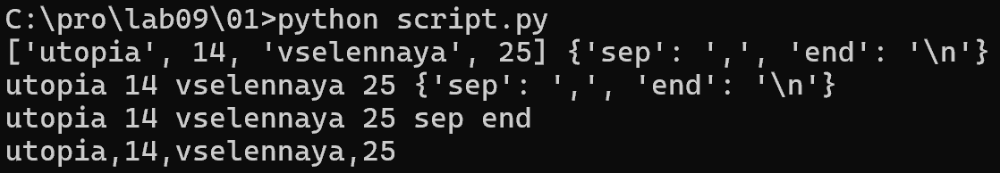
*Объясните результаты ее работы.*

## Пояснение

1) `print(l, d)` - выводит список l и словарь d как объекты.
   print разделяет их пробелом.

2) `print(*l, d)` - `*l` распаковывает список, то есть
   print получает элементы списка и словарь d как отдельный
   аргумент.

3) `print(*l, *d)` - `*l` распаковывает список (элементы),
   `*d` распаковывает словарь. При распаковке словаря через *
   берутся только ключи ('sep', 'end').

4) `print(*l, **d)` - `*l` распаковывает список (элементы),
   `**d` распаковывает словарь в именованные параметры.
   `sep=''` (без разделителя), `end='`. `\n'` (в конце точка
   и перевод строки). Поэтому все элементы слитно,
   а в конце точка.

## Вывод

Звёздочка * распаковывает последовательность в позиционные
аргументы. Две звёздочки ** распаковывают словарь
в именованные аргументы.

*При устном ответе на вопросы вам потребуется рассказать, что такое "Утопия 14" и "Вселенная 25".*


### Задание 2 **(2)**
*Напишите функцию* **sublist** для решения следующей задачи.*

```
def sublist(lst, *nums):
	return [lst[i] for i in nums]

lst = ['Anna', 'Barbara', 'Clara', 'Diana', 'Eva', 'Flora']

print(sublist(lst, 0, 2, 5))
print(sublist(lst))
print(sublist(lst, 0, 1, 2, 3, 4, 5))
```
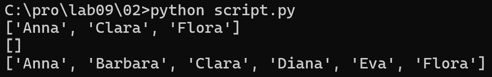

*На вход функции поступает список или кортеж и набор номеров позиций.
Функция должна составить и вернуть список из элементов, которые
находятся на этих позициях. Примеры работы приводятся ниже. Работа функции должна строго им соответствовать.*

```
>>> lst = [ 'Anna', 'Barbara', 'Clara', 'Diana', 'Eva', 'Flora']
>>> sublist(lst, 0, 2, 5)
['Anna', 'Clara', 'Flora']
>>> sublist (lst)
[]
>>> sublist(lst, 0, 1, 2, 3, 4, 5)
['Anna', 'Barbara', 'Clara', 'Diana', 'Eva', 'Flora']
```

## Пояснение

Функция `sublist(lst, *args)` принимает список lst и любое
количество индексов, которые упаковываются в кортеж args.

С помощью генератора списка `[lst[i] for i in args]`
мы проходим по всем переданным индексам и берём элементы
из списка по этим индексам.

Если индексы не переданы `(sublist(lst))`, то args - пустой
кортеж, генератор ничего не возвращает, получается [].

## Вывод

Функция использует `*args` для приёма произвольного числа
индексов и генератор списка для их обработки.


### Задание 3 **(1)**

*Задан список* **lst** *из натуральных чисел*. *Напишите фрагмент
программы, состоящий из одного вызова функции* **max**, *который найдет в этом списке число с максимальным
числом единиц в двоичной записи.* 

```
lst = list(range(6000 ,7000))

x = max(lst, key=lambda x: bin(x).count('1'))

print(x)
```
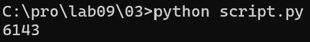

*Многоточие надо заменить на лямбда-функцию, использующую фукцию* **bin** *и метод строк* **count**.

*Пример работы приводится ниже.*
```
>>> lst = list(range(6000 ,7000))
>>> ans = max(lst,...)
>>> print(ans)
6143
```

## Пояснение

Функция max ищет максимальный элемент. С помощью ключевого
параметра key мы задаем правило сравнения: сравнивать
не сами числа, а количество единиц в их двоичной записи.

`lambda x: bin(x).count('1')` - это анонимная функция.
Она переводит число x в двоичную строку `(bin(x))`
и считает количество символов '1' `(метод count)`.

Максимальное число единиц среди чисел от 6000 до 7000
находится у числа 6143. Его двоичная запись 1011111111111
содержит 12 единиц.

## Вывод

Функция max с ключевым параметром key позволяет искать
элемент по заданному критерию, а не по самому значению.


### Задание 4 **(2)**

*Запишите фрагмент программы, которая упорядочит список слов
по длине, а при равенстве длины - лексикографически. Сортировка
должна состоять из одного вызова метода* **sort**.

```
lst = ['hello', 'hell', 'bye', 'world', 'bybye']
lst.sort (key = lambda x: (len(x), x))
print (lst)
```
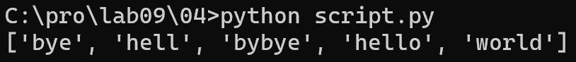

*Пример работы приводится ниже.*

```
>>> lst = ['hello', 'hell', 'bye', 'world', 'bybye']
>>> lst.sort (...)
>>> print (lst)
['bye', 'hell', 'babye', 'hello', 'world']
```

## Пояснение

Метод `sort` принимает параметр key — функцию, которая
определяет критерий сортировки.

`lambda x: (len(x), x)` — анонимная функция, которая
для каждого слова возвращает кортеж из двух элементов:
1) длина слова;
2) само слово.

Python сравнивает кортежи поэлементно: сначала
сравниваются длины. Если длины равны, сравниваются
сами слова (лексикографически).

## Вывод

Сортировка по кортежу `(len(x), x)` позволяет
упорядочить слова сначала по длине, а при равенстве
длины — по алфавиту, используя один вызов метода sort.


### Задание 5 **(2)**

*Напишите программу для решения следующей задачи.*

```
print(
	*map(len, map(str.strip,
		input().split(','))
		) ,
sep=','
	)
```
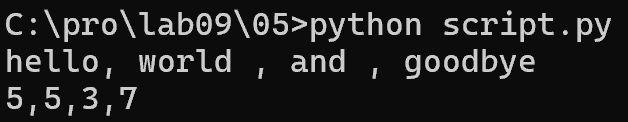

*В одной строке через запятую записана последовательность слов. Перед
запятой или после нее могут быть пробелы, сами слова пробелов не
содержат. Программа должна вывести в одной строке через запятую
последовательность чисел, равных длине каждого слова. Например,
для ввода*
```
hello   ,   world ,   and ,   goodbye
```
*программа должна вывести*
```
5, 5, 3, 7
```
*Программа должна быть написана с использованием парадигмы функционального программирования, то есть без использования циклов, присваиваний и т.д. Программа может использовать функции* **input**, **print**, **len**, **map** *и методы строк* **split** и **strip**.

## Пояснение

1) `text.split(',')` разбивает строку по запятым.
   Получается список слов с пробелами по краям.

2) `map(str.strip, ...)` применяет функцию str.strip
   к каждому слову. str.strip удаляет пробелы
   в начале и конце строки.

3) `map(len, ...)` применяет функцию len к каждому слову
   и возвращает его длину.

4) `print(*lengths, sep=', ')` распаковывает результаты
   и выводит их через запятую с пробелом.

Циклы в явном виде не используются, только функция map.

## Вывод

Функция map позволяет применить функцию к каждому
элементу последовательности без явного цикла.


### Задание 6 **(2)**

*Запишите генератор в форме функции, который будет создавать
последовательность по следующему правилу.*

```
def gen(x):
	yield x
	while x != 1:
		if x%2 ==0:
			x//=2
		else:
			x = 3*x+1
	yield x
print(*gen(17))
```
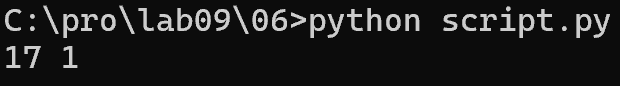

* *Если текущее число x в последовательности четное, то следующее число равно x/2.*
* *Иначе следующее число равно 3x + 1.* 

*Последовательность начинается с заданного числа n и заканчивается единицей.*

*Далее приведен пример работы генератора.*
```
>>> print (*gen(7))
7 22 11 34 17 52 26 13 40 20 10 5 16 8 4 2 1
```

## Пояснение

Генератор — это функция с ключевым словом yield.
При вызове yield функция отдает значение и замирает,
а при следующем запросе продолжает с того же места.

В цикле while n != 1:
1) yield n отдает текущее число.
2) Если число четное, оно делится на 2 (целочисленно, //).
3) Если нечетное, умножается на 3 и прибавляется 1.

Когда n становится 1, цикл завершается, и мы отдаем
последнюю единицу через yield 1.

`print(*gen(7))` распаковывает генератор и выводит все числа.

## Вывод

Генератор позволяет создавать последовательность
по запросу, не храня все элементы в памяти.


### Задание 7 **(2)**

*Напишите генератор, который для заданной последовательности*
**seq** *будет задавать последовательность из каждого второго элемента* **seq**.

```
def every_other(seq):
    ...
```
*Ниже приведены примеры использования генератра.*
```
>>> print (*every_other([10, 20, 30, 40, 50]))
10 30 50
>>> print(*every_other(range(10)))
0 2 4 6 8
>>> print(*every_other(iter(range(10))))
0 2 4 6 8
>>> print(sum(every_other(map(int, input().split()))))
2 5 11 3 8
21
```

```
def gen(n):
    while n != 1:
        yield n
        if n % 2 == 0:
            n = n // 2
        else:
            n = n * 3 + 1
    yield 1

def every_other(seq):
    it = iter(seq)
    x = next(it, None)
    while x is not None:
        yield x
        next(it, None)
        x = next(it, None)

print(*gen(7))
print(*every_other([10, 20, 30, 40, 50]))
print(*every_other(range(10)))
```
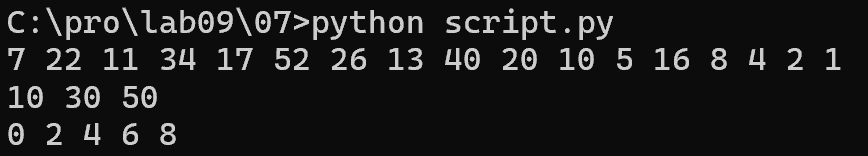


## Пояснение

В генераторе gen мы сначала проверяем, не равна ли n единице.
Если нет - отдаем n, а затем меняем его по правилу Коллатца.
Когда цикл завершается, отдаем последнюю единицу.

В генераторе every_other мы создаем итератор it. Берем первый
элемент. Пока элемент не None, отдаем его, затем пропускаем
один элемент (next(it, None)) и берем следующий.

Второй аргумент None в next() защищает от ошибки StopIteration,
если последовательность закончится не на четном шаге.

## Вывод

Генератор every_other берет каждый второй элемент,
используя итератор и функцию next.


### Задание 8 **(2)**

*Задан список* **lst**, *в котором записаны вперемешку числа и строки.*. 
*Напишите фрагмент программы, состоящий из одного конструктора списков, который построит новый список, состоящий только из чисел.* 

```
lst = [1, 'abc', 2, 3, 4, 'aa']

nums = list(filter(lambda x: type(x) == int, lst))

print(nums)
```
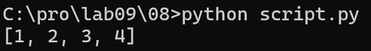

*Определить тип объекта в Python можно с использованием функции* **type**.

*Пример работы приводится ниже.*

```
>>> lst = [1,'abc', 2, 3, 4, 'aa']
>>> nums = [...]
>>> print(nums)
[1, 2, 3, 4]
```

## Пояснение

Функция `filter` принимает два аргумента: функцию-условие
и последовательность. Она оставляет только те элементы,
для которых функция-условие вернула `True`.

`lambda x: type(x) == int` - анонимная функция, которая
проверяет, является ли элемент целым числом.

`list(...)` превращает результат в список.

## Вывод

Функция filter позволяет отфильтровать элементы списка
без явных циклов.


###  Задание 9 **(2)**

*Напишите фрагмент программы, состоящий из одного конструктора списков, который построит двумерный список в виде таблицы умножения размера* 
**nxn**.

```
n = 5

tblmul = [[i * j for j in range(1, n + 1)] for i in range(1, n + 1)]

print(*tblmul, sep='\n')
```
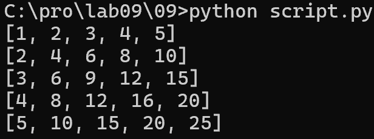

*Пример работы приводится ниже.*

```
>>> n = 5
>>> tblmul = [...]
>>> print(*tblmul,sep='\n')
[1, 2, 3, 4, 5]
[2, 4, 6, 8, 10]
[3, 6, 9, 12, 15]
[4, 8, 12, 16, 20]
[5, 10, 15, 20, 25]
```

## Пояснение

Двумерный список создается одной строкой с помощью 
вложенного генератора списка.

Внешний генератор `[ ... for i in range(1, n + 1)]` 
создает строки таблицы. Переменная i принимает значения 
от 1 до n.

Внутренний генератор `[i * j for j in range(1, n + 1)]` 
создает элементы каждой строки. Переменная j принимает 
значения от 1 до n.

Каждый элемент таблицы равен произведению `i * j`.

## Вывод

Программа создает таблицу умножения размером 5x5
с помощью вложенного генератора списка, без использования
циклов.


###  Задание 10 **(1)**
*Какие из указанных функций и методов Python соответствуют определению чистых функций?
В случае отрицательного ответа требуется дать пояснение.*

* **file.readline|** — *чтение строки из файла.*
* **len** — *определение длины строки или количества элементов в контейнере.*
* **list.append** — *добавление в список нового элемента.*
* **sum** — *нахождение суммы.*
* **sorted** — *построение сортированного списка.*
* **list.sort** — *сортировка списка.*
* **random.randint** — *генерация случайного целого числа.*
* *Разворот списка.*
```
def rev(x):
    return x[::-1]
```
* *Выбор нескольких элементов из хвоста списка.*
```
tail_len = 3
def tail(x):
    return x[-tail_len:]
```

## Определение чистой функции

Чистая функция не выполняет побочных действий и ее результат
зависит только от ее параметров.

## Ответы

1) `file.readline` - НЕ чистая.
   Чтение файла - это побочное действие (меняется позиция
   курсора в файле).

2) `len` - чистая.
   Просто возвращает длину. Ничего не меняет.

3) `list.append` - НЕ чистая.
   Изменяет список (побочное действие).

4) `sum` - чистая.
   Просто суммирует. Ничего не меняет.

5) `sorted` - чистая.
   Создает новый список, исходный не меняется.

6) `random.randint` - НЕ чистая.
   Возвращает случайное число. Результат не зависит
   от аргументов, а зависит от внутреннего состояния.

7) `rev(x) = x[::-1]` - чистая.
   Создает новый список в обратном порядке.

8) `tail(x) = x[-tail_len:]` - НЕ чистая.
   Использует глобальную переменную tail_len.
   Результат зависит не только от x, но и от tail_len.

## Вывод

Чистыми являются: len, sum, sorted, rev.
Не чистыми: file.readline, list.append, random.randint, tail


###  Задание 11 **(2)**
*Рассмотрите следующую функцию.*
```
def toint(fun):
    def wrapper(*args):
        return fun(*map(int, args))
    return wrapper
```
*Что передается в функцию* **toint**? *Что возвращает эта функция?*
*Что делает функция* **wrapper**?
*Придумайте несколько примеров использования* **toint**.

## Ответы на вопросы

1) Что передаётся в toint?
   В toint передаётся другая функция (fun). Например, max, min, pow.

2) Что возвращает toint?
   toint возвращает новую функцию wrapper.

3) Что делает wrapper?
   wrapper принимает любое количество аргументов `(*args)`,
   переводит их в целые числа с помощью map(int, args)
   и вызывает исходную функцию fun с этими числами.

## Примеры использования

### Пример 1 

```
def toint(fun):
    def wrapper(*args):
        return fun(*map(int, args))
    return wrapper

int_max = toint(max)
print(int_max('5', '10', '3'))
```
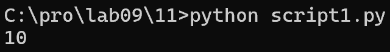

### Пример 2

```
def toint(fun):
    def wrapper(*args):
        return fun(*map(int, args))
    return wrapper

int_min = toint(min)
print(int_min('5', '10', '3'))
```
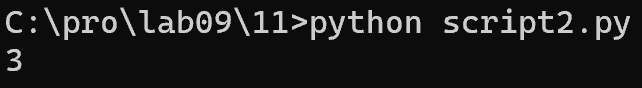

### Пример 3 

```
def toint(fun):
    def wrapper(*args):
        return fun(*map(int, args))
    return wrapper

int_pow = toint(pow)
print(int_pow('2', '3'))
```
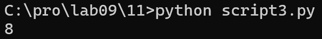

## Пояснение

Функция toint — это фабрика функций. Она принимает 
другую функцию и создает новую (wrapper), которая 
перед вызовом преобразует все аргументы в целые числа.

## Вывод

toint позволяет создать обертку над любой функцией, 
чтобы она автоматически преобразовывала аргументы 
в целые числа. Это пример использования функций 
высших порядков и замыканий.


## Дополнительные задания

### Задание 1 **(3)**

*Самостоятельно познакомьтесь с понятием декораторов в Python. Приведите примеры использования
функции* **toint** *из задания выше в качестве декоратора.*


### Задание 2 **(3)**
*Напишите фрагмент программы, которая найдет в списке слов слово с максимальной длиной. При равенстве длин
найдет самое первое в лексикографическом порядке.*

*Фрагмент программы должен состоять из одного вызова функции* **min** *или* **max**.

### Задание 3 **(5)**

*Напишите рекурсивную функцию для нахождения* **n**-о *числа Фибоначчи.*

*Функция обязательно должна работать с достаточно большими числами, например* **n = 1000** *и не 
должна использовать библиотечные функции и методы.*

### Задание 4 **(9)**

*Напишите функцию* **fastpow**, *которая будет создавать лямбда-функцию для быстрого 
возведения в фиксированную степень* **n**. *Например, должен работать следующий код*
```
>>> pow10 = fastpow(10)
>>> print(pow10(2))
1024
```
*Функция* **fastpow** *в этом примере должна строить выражение для быстрого возведения в степень
по стандартному алгоритму* 
* **x^1 = x**;
* **x^{2n} = (x^n) ** 2**; 
* **x^{2n+1}=x*x^{2n}**;

*Например,
для* **n = 10** *может быть получена подобная строка* ```(x*((x**2)**2))**2```. 

*Далее* **fastpow** *будет возвращать лямбда функцию*
```
lambda x: eval(s)
```
*При написании функции* **fastpow** *можно использовать вспомогательные функции.*


