# Языки программирования
## Лабораторная работа 10

### Задание 1 **(2)**

*Рассмотрите следующие фрагменты программ. Запишите, что означают символы* **&** и  * *в каждом случае применения.*
```
int a = 10, b = 20;
int *p = &a , *q = &b;
p = q;
std::cout << *p <<' '<< *q << std::endl;
```
```
int a = 10, b = 20;
int *p = &a , *q = &b;
*p = *q;
std::cout << *p <<' '<< *q << std::endl;
```
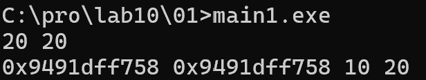

1) int *p = &a, *q = &b;
   Здесь * в объявлении (int *p) — это описатель указателя.
   Символ & (перед a и b) — это оператор взятия адреса.
   То есть p хранит адрес a, а q хранит адрес b.

2) p = q; или *p = *q;
   В этих выражениях * — это оператор разыменования (получение
   значения по адресу).


## Программа 1

```
#include <iostream>
using namespace std;
int main(){
    int a=10, b=20;
    int *p=&a, *q=&b;
    p=q;
    cout<<*p<<" "<<*q<<endl;
    cout<<p<<" "<<q<<" "<<a<<" "<<b<<endl;
    return 0;
}
```


p = q копирует адрес. Теперь указатель p указывает
на ту же ячейку, что и q (на переменную b). Значения переменных
a и b не меняются. Меняется только адрес, на который смотрит p.
Если вывести адреса p и q, они станут одинаковыми.


## Программа 2 

```
#include <iostream>
using namespace std;
int main(){
    int a=10, b=20;
    int *p=&a, *q=&b;
    *p=*q;
    cout<<*p<<" "<<*q<<endl;
    cout<<p<<" "<<q<<" "<<a<<" "<<b<<endl;
    return 0;
}
```
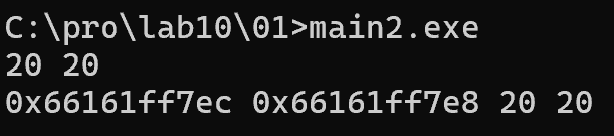

*p = *q копирует значение. Значение b (20)
записывается в a. Указатели p и q остаются на своих местах
(p смотрит на a, q на b), но значение переменной a меняется на 20.
Если вывести адреса p и q, они останутся разными.


*Чем различаются присваивания в третьей строке? Что можно вывести,
чтобы показать различия?*

p = q меняет адрес указателя.
*p = *q меняет значение по адресу.

*Примеры программ сохраните в папке с номером задания. Скриншоты работы прикрепите к отчету.*


### Задание 2 **(1)**

*Рассмотрим следующую программу.* 
```
double x[10];
for (int i = 0; i <10; i++)
    std::cout << &x[i] << std::endl;
```

## Код 

```
#include <iostream>

int main(){
    double x[10];
    for (int i = 0; i < 10; i++)
        std::cout << &x[i] << ' ' << reinterpret_cast<size_t>(&x[i]) << std::endl;
    return 0;
}
```
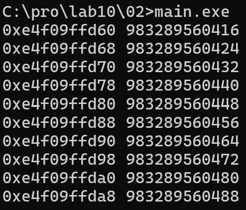

## Пояснение

Исходная программа выводит адреса элементов массива x в 
шестнадцатеричном виде (так как cout по умолчанию выводит 
указатели в hex).

Мы изменили вывод, добавив reinterpret_cast<size_t>(&x[i]).
Этот оператор преобразует указатель в беззнаковое целое число,
которое выводится в десятичной системе.

Почему адреса составляют арифметическую прогрессию:
1) Массив x состоит из 10 элементов типа double.
2) В памяти элементы массива располагаются строго 
   последовательно, друг за другом.
3) Размер одного элемента double равен 8 байтам.
4) Поэтому каждый следующий адрес больше предыдущего ровно 
   на 8. Шаг прогрессии равен 8 (sizeof(double)).


*Что она выводит? Измените
вывод так, чтобы адреса выводились в десятичной системе счисления.
Объясните почему числа составляют арифметическую прогрессию с
определенным шагом.*

*Записанную программу сохраните в папке с номером задания.*
*Скриншоты работы прикрепите к отчету.*


### Задание 3 **(2)**

*Токен* **«*»** *в языке C++ может использоваться в трех различных
случаях. Аналогично токен* **«&»** *также может использоваться в трех
случаях. Приведите пример одной программы в которой они были бы
использованы во всех случаях.*

```
#include <iostream>
using namespace std;

int main() {
    int a = 5, b = 3;
    int c = 10;
    
    int mult = a * b;
    
    int *p = &a; 
    
    *p = 15;
    
    int bitwise = c & b; 
    
    int &ref = c;
    ref = 20;
    
    cout << "a = " << a << endl;
    cout << "bitwise = " << bitwise << endl;
    cout << "c = " << c << endl;
    
    return 0;
}
```
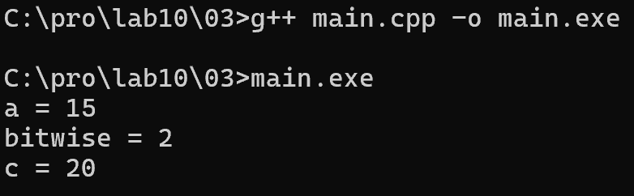

## Пояснение

В программе символ * используется трижды:
1) `a * b` - умножение.
2) `int *p` - описатель указателя.
3) `*p = 15` - разыменование (запись по адресу).

Символ & также используется трижды:
1) `&a` - оператор взятия адреса.
2) `c & b` - побитовое И (3 в двоичном 011, 10 в двоичном 1010,
   результат 0010 = 2).
3) `int &ref = c` - описатель ссылки (ref становится
   псевдонимом c, изменение ref меняет c).

*Записанную программу сохраните в папке с номером задания.*


### Задание 4 **(2)**

*Выпишите значения всех переменных, в том числе указателей,
после выполнения каждой инструкции программы. Объясните, что
происходит в результате выполнения каждой инструкции.*
```
unsigned a = 8, b = 3 ,c = 17;
unsigned *p = &a;
unsigned *q = &b;
*p += *q + c;
c = *q;
p = &c;
c += a;
*p += 10;
*q = *p;
q = p ;
*q += 10;
```


## код

```
#include <iostream>
using namespace std;

int main() {
    unsigned a = 8, b = 3, c = 17;
    unsigned *p = &a;
    unsigned *q = &b;

    *p += *q + c;
    c = *q;
    p = &c;
    c += a;
    *p += 10;
    *q = *p;
    q = p;
    *q += 10;

    cout << "a = " << a << endl;
    cout << "b = " << b << endl;
    cout << "c = " << c << endl;
    cout << "*p = " << *p << endl;
    cout << "*q = " << *q << endl;

    return 0;
}
```
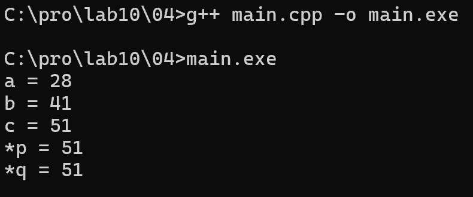

## Пояснение

Начальные значения: a = 8, b = 3, c = 17.
Указатель p указывает на a, указатель q указывает на b.

1) `*p += *q + c;`
   Считаем правую часть: `*q (это b=3) + c (17) = 20.`
   `*p (a) = 8 + 20 = 28.`
   Состояние: `a=28, b=3, c=17, p->a, q->b.`

2) `c = *q;`
   `*q = 3`. Присваиваем это c.
   Состояние: `a=28, b=3, c=3, p->a, q->b`.

3) `p = &c;`
   Указатель p теперь указывает на c.
   Состояние: `a=28, b=3, c=3, p->c, q->b`.

4) `c += a;`
   `c = 3 + 28 = 31`.
   Состояние: `a=28, b=3, c=31, p->c, q->b`.

5) `*p += 10;`
   p указывает на c. `c = 31 + 10 = 41`.
   Состояние: `a=28, b=3, c=41, p->c, q->b`.

6) `*q = *p;`
   `*p = 41` (значение c). Записываем в b.
   `b = 41.`
   Состояние: `a=28, b=41, c=41, p->c, q->b`.

7) `q = p;`
   Указатель q теперь указывает на c.
   Состояние: `a=28, b=41, c=41, p->c, q->c`.

8) `*q += 10;`
   q указывает на c. `c = 41 + 10 = 51`.
   Состояние: `a=28, b=41, c=51, p->c, q->c`.


### Задание 5 **(1)**

*Что сравнивается в приведенной ниже программе? Как можно
изменить первую строчку программы, чтобы результат тоже
изменился?*
```
int x = 1, y = 2;
int *p = &y, *q = &x;
if (p < q)
    std::cout << "Yes";
else
    std::cout << "No";
```

## Код 

#include <iostream>

```
int main() {
    int x = 1, y = 2;
    int *p = &y, *q = &x;

    if (p < q){
        std::cout << "Yes" << std::endl;}
    else {
        std::cout << "No" << std::endl; }

    return 0;
}
```
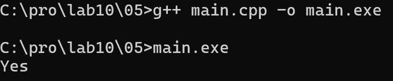

## Пояснение

В условии if (p < q) сравниваются не значения переменных
x и y (то есть не 1 и 2), а адреса памяти, на которые
указывают указатели p и q.

Указатель p указывает на переменную y (&y), а указатель q
указывает на переменную x (&x). Компилятор размещает
переменные в памяти, и их адреса сравниваются как обычные числа.

Результат зависит от того, как компилятор расположил
переменные в памяти (какая из них идет первой).

Чтобы изменить результат программы (с "Yes" на "No" или наоборот),
нужно изменить первую строку с объявлением указателей так,
чтобы они поменялись местами:
int *p = &x, *q = &y;

Тогда p будет указывать на x, а q на y. Так как адреса переменных
фиксированы, знак неравенства изменится на противоположный.


### Задание 6 **(2)**

*Объясните работу следующей программы. Как изменится
результат, если тип* **double** *изменить на некоторый другой, например*
**int** *или* **char**?
```
double x = 0;
double *d = &x;
std::cout << reinterpret_cast<size_t>(d + 4) - reinterpret_cast<size_t>(d - 4) << std::endl;
```

## Код 

```
#include <iostream>

int main(){
    double x = 0;
    double *d = &x;
    std::cout<<"d = "<< reinterpret_cast<size_t>(d)<<std::endl;
    std::cout<<"d+4 = "<< reinterpret_cast<size_t>(d+4)<<std::endl;
    std::cout<<"d-4 = "<< reinterpret_cast<size_t>(d-4)<<std::endl;
    
    std::cout << reinterpret_cast<size_t>(d + 4) - reinterpret_cast<size_t>(d - 4) << std::endl;
    return 0;
}
```
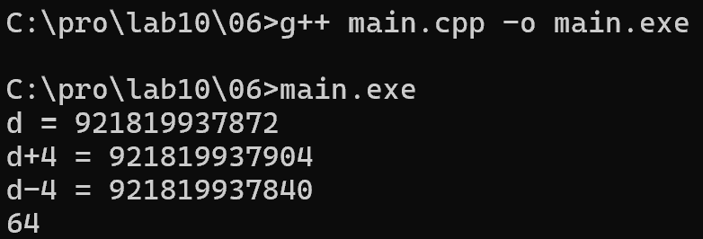

## Пояснение

Оператор d + 4 сдвигает указатель на 4 элемента вперед,
а d - 4 — на 4 элемента назад. Так как указатель имеет
тип double, при сдвиге учитывается размер этого типа (8 байт).

- d + 4 смещает адрес на 4 * 8 = 32 байта.
- d - 4 смещает адрес на -4 * 8 = -32 байта.

Разность между этими адресами: 32 - (-32) = 64.


## Как изменится результат для других типов

Результат зависит от размера типа данных:

1) Если заменить double на int (размер 4 байта):
   (4 * 4) - (-4 * 4) = 16 + 16 = 32.

2) Если заменить double на char (размер 1 байт):
   (4 * 1) - (-4 * 1) = 4 + 4 = 8.


### Задание 7 **(2)**

*Объясните работу следующей программы. Как изменится
результат, если тип* **double** *изменить на некоторый другой, например*
**int** *или* **char**?
```
std::cout << reinterpret_cast <double*>(3000) - reinterpret_cast <double*>(2000) << std::endl;
```

## Код 

```
#include <iostream>

int main(){
    std::cout << reinterpret_cast <double*>(3000) - reinterpret_cast <double*>(2000) << std::endl;
    return 0;
}
```
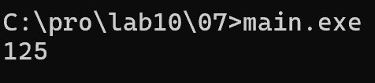

## Пояснение

Оператор reinterpret_cast<double*>(3000) превращает целое число 3000 
в указатель на тип double (то есть адрес в памяти равен 3000). 
Аналогично число 2000 превращается в указатель на double с адресом 2000.

При вычитании двух указателей одного типа результат равен разности 
их адресов, деленной на размер типа (sizeof).

Разность адресов: 3000 - 2000 = 1000.
Размер типа double = 8 байт.
Результат: 1000 / 8 = 125.

## Как изменится результат для других типов

Если заменить double на int (размер 4 байта):
1000 / 4 = 250.

Если заменить double на char (размер 1 байт):
1000 / 1 = 1000.


### Задание 8 **(2)**

*Что надо дописать в записанной ниже программе вместо многоточий, чтобы
она выводила все числа из массива* **a**? *Почему?*
```
int a[20];
for ( int i = 0; i < 20; i++)
    a[i] = i;
int *b=a + 8;
for (int i =...; i <...; i++)
    std::cout << b[i] <<' ';
```

## Код 

```
#include <iostream>
int main(){
    int a[20];
    for ( int i = 0; i < 20; i++)
        a[i] = i;
    int *b=a + 0;
    for (int i = 0; i < 20; i++)
        std::cout << b[i] << ' ';
    return 0;
}
```
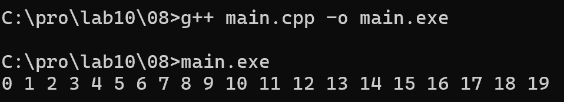

## Пояснение

Вместо многоточий нужно дописать: i = 0; i < 20.

Почему:
1) Переменная b - это указатель на первый элемент массива a 
   (так как b = a + 0).
2) Конструкция b[i] в C++ эквивалентна *(b + i). Она берет 
   значение по адресу, сдвинутому на i элементов от начала b.
3) Чтобы вывести все 20 элементов, индекс i должен меняться 
   от 0 до 19 (то есть пока i < 20).

Если бы в строке инициализации указателя было написано 
int *b = a + 8;, то b указывал бы на 8-й элемент (a[8]). 
Тогда для вывода оставшейся части массива (с 8-го по 19-й) 
цикл должен был бы идти от i = 0 до i < 12, так как 
b[0] соответствовало бы a[8], b[1] — a[9] и так далее.


### Задание 9 **(2)**

*Что выводит следующая программа? Изменится ли результат если
изменить тип элементов массива?*

```
int a[10];
std::cout << &a[8] - &a[3] << std::endl;
```

## Код 

```
#include <iostream>
using namespace std;

int main() {
    int a[10];
    cout << &a[8] - &a[3] << endl;
    return 0;
}
```
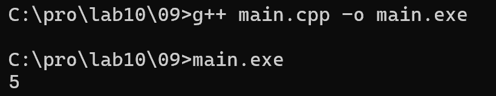

## Пояснение

В программе вычисляется разность адресов двух элементов
массива: &a[8] и &a[3].

В C++ при вычитании двух указателей одного типа
результат равен разности их адресов, деленной на
размер типа (sizeof). То есть вычитание указателей
возвращает не разницу в байтах, а количество элементов,
которые помещаются между ними.

Элементы массива идут в памяти подряд. Между индексом 3
и индексом 8 находится ровно 5 элементов (индексы 4, 5, 6, 7, 8).
Поэтому (адрес 8-го - адрес 3-го) / sizeof(int) = 5.

## Изменится ли результат при смене типа?

Нет, результат останется тем же (5).

Если написать double a[10] или char a[10], ответ все равно
будет 5. Потому что компилятор при вычитании указателей
автоматически делит разницу в байтах на размер типа.


### Задание 10 **(1)**

*Есть ли разница между инициализацией* **p** и **q** *в следующей программе? Обоснуйте ответ.*
```
int x [10]={1, 2, 3, 4, 5, 6, 7, 8, 9, 10};
int *p = x + 5;
int *q = &x[5];
```

## Код 

```
#include <iostream>
using namespace std;

int main() {
    int x[10] = {1, 2, 3, 4, 5, 6, 7, 8, 9, 10};
    int *p = x + 5;
    int *q = &x[5];
    
    cout << "p = " << p << endl;
    cout << "q = " << q << endl;
    cout << "p == q: " << (p == q) << endl;
    cout << "*p = " << *p << endl;
    cout << "*q = " << *q << endl;
    
    return 0;
}
```
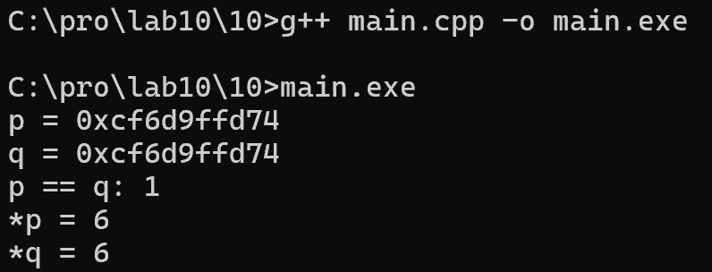

## Пояснение

Разницы нет. Оба указателя (p и q) будут хранить один и тот же
адрес - адрес 5-го элемента массива.

1) int *p = x + 5;
   Имя массива x в C++ является указателем на первый элемент
   (x == &x[0]). Выражение x + 5 означает сдвиг указателя
   на 5 элементов вперед (арифметика указателей).

2) int *q = &x[5];
   Здесь мы напрямую берем адрес 5-го элемента массива
   с помощью оператора взятия адреса &.

По стандарту C++ запись x[i] эквивалентна *(x + i), 
поэтому &x[i] эквивалентно x + i. Значит, оба способа
приводят к одному результату.


### Задание 11 **(3)**

*Указатели можно использовать для итерации по массивам.
Напишите программу, которая найдет сумму элементов массива,
используя указатели. В начале цикла указатель требуется установить
на начало массива, в конце каждой итерации смещать его к
следующему элементу массива через инкремент. Для выхода из цикла
надо проверять, что указатель дошел до конца массива.*
```
int x [10]={1, 2, 3, 4, 5, 6, 7, 8, 9, 10};
int s = 0;
for (int *p = ...; ...; ...)
    s += ...
std::cout << s;
```

## Код 

```
#include <iostream>
using namespace std;

int main() {
    int x[10] = {1, 2, 3, 4, 5, 6, 7, 8, 9, 10};
    int s = 0;
    
    for (int *p = x; p < x + 10; p++) {
        s += *p;
    }
    
    cout << s << endl;
    
    return 0;
}
```
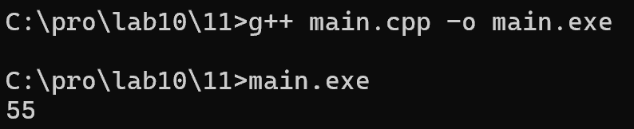

## Пояснение

Вместо многоточий вписано:
1) int *p = x;
   Указатель p устанавливается на начало массива (на элемент x[0]).

2) p < x + 10;
   Условие продолжения цикла. x + 10 - это адрес, следующий
   за последним элементом. Пока p меньше, мы не вышли за границы.

3) p++
   Инкремент указателя. Сдвигает его на следующий элемент массива.

4) s += *p;
   Разыменование указателя. Берем значение, на которое указывает p
   (текущий элемент массива), и добавляем к сумме s.

*Записанную программу сохраните в папке с номером задания.*


## Дополнительные задания

### Задание 1 **(3)**

*Запишите программу на С++, в которой будет создаваться двумерный массив* **x[10][10]**. *Выведите адреса элементов массива и нарисуйте, как элементы расположены в памяти.*

### Задание 2 **(3)**

*Запишите программу на С++, в которой будет создаваться двумерный массив* **x[10][10]**. *Проверьте, что произойдет при различных выходах за границы массива. Напишите программы для демонстрации и поясните
их работу.* 

### Задание 3 **(6)**
*Напишите пример программы, которая продемонстрирует неопределенное поведение при выходе за границу одномерного массива. Например, чтобы программа зависла, хотя по алгоритму такого не должно произойти

### Задание 4 **(8)**
*Изучите самостоятельно работу с динамической памятью. Напишите примеры программ, демонстрирующие особенности работы (например, перемещение при расширении) и возможные ошибки при работе с памятью.* 
